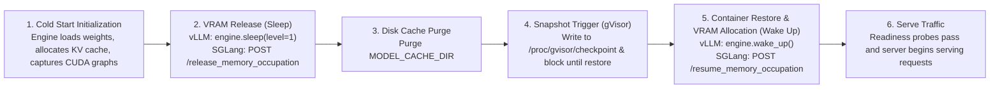

# GKE Fast Pod Snapshot Utility for vLLM and SGLang

A modular container snapshot provider and model server wrapper that enables fast pod checkpointing and restoration for **vLLM** and **SGLang** on Google Kubernetes Engine (GKE) with GKE Sandbox (gVisor) and NVIDIA GPUs.

---

## Overview

Deploying large language models (LLMs) on Kubernetes often incurs high cold-start latencies due to downloading weights, loading them into memory, allocating GPU VRAM, and compiling CUDA graphs.

This package provides drop-in launchers (`docker.scripts.snapshot.launcher` for vLLM, `docker.scripts.snapshot.sglang.launcher` for SGLang) and a snapshot provider that hook into model server startup to:

1. Initialize the engine, allocate KV cache, and capture CUDA graphs during container cold start.
2. Release physical GPU VRAM while preserving virtual memory mappings and host RAM weight backups (`engine.sleep(level=1)` in vLLM; `POST /release_memory_occupation` in SGLang).
3. Purge cached model weight files from disk (`MODEL_CACHE_DIR`) to minimize the checkpoint storage footprint.
4. Trigger a gVisor userspace checkpoint via `/proc/gvisor/checkpoint`.
5. Restore the container and wake up GPU memory (`engine.wake_up()` in vLLM; `POST /resume_memory_occupation` in SGLang) to re-allocate physical GPU VRAM before reporting ready to serve traffic.

> [!NOTE]
> This README is intended for developers maintaining and integrating this snapshot utility. For a comprehensive user guide on single-GPU deployment, cluster configuration, and verification, see the [Pod Snapshots User Guide](../../../guides/pod-snapshot/README.md).

---

## Architecture & Lifecycle

The snapshot lifecycle is orchestrated during server startup—inside the FastAPI application lifespan context manager for vLLM ([`vllm/wrapper.py`](vllm/wrapper.py)) or via post-warmup startup callbacks for SGLang ([`sglang/wrapper.py`](sglang/wrapper.py)):



---

## Package Layout & Components

```text
docker/scripts/snapshot/
├── __init__.py           # Package exports (GKESnapshotProvider, SnapshotError, get_snapshot_provider)
├── kustomization.yaml    # Kustomize configMapGenerator for snapshot-scripts, vllm, and sglang
├── launcher.py           # CLI entrypoint wrapping vllm serve
├── providers.py          # GKESnapshotProvider and provider factory
├── test_providers.py     # Unit test suite
├── README.md             # Developer documentation
├── sglang/
│   ├── __init__.py       # SGLang integration exports
│   ├── launcher.py       # CLI entrypoint wrapping SGLang's launch_server
│   └── wrapper.py        # Warmup hook and snapshot callback
└── vllm/
    ├── __init__.py       # vLLM integration exports
    └── wrapper.py        # FastAPI lifespan context manager patch
```

### Component Details

- **[`launcher.py`](launcher.py)**:
  CLI entrypoint intended to replace `vllm serve` or `python3 -m vllm.entrypoints.openai.api_server`. It dynamically intercepts `vllm.entrypoints.launchers.app.build_app` (falling back to `vllm.entrypoints.openai.api_server.build_app` on vLLM `< v0.29.0`) to apply `patch_vllm_lifespan()` to the FastAPI application before passing control to `vllm.entrypoints.cli.main()`.

- **[`vllm/wrapper.py`](vllm/wrapper.py) (`patch_vllm_lifespan`)**:
  Wraps the FastAPI application's `router.lifespan_context`. During startup, after the original lifespan context initializes the vLLM engine:
  - Calls `await engine.sleep(level=1)` to release physical GPU memory.
  - Calls `snapshot_provider.trigger()` in a separate thread.
  - Upon process resumption, calls `await engine.wake_up()` to restore GPU memory mappings.
  - Resumes the lifespan lifecycle, allowing Uvicorn to bind TCP ports.

- **[`providers.py`](providers.py) (`GKESnapshotProvider`)**:
  Handles the low-level interaction with gVisor's `/proc/gvisor/checkpoint` interface:
  - `clear_cache()`: Recursively deletes downloaded model weight files from `MODEL_CACHE_DIR` to reduce checkpoint size.
  - `is_available()`: Checks if the procfs checkpoint trigger file is writable.
  - `trigger()`: Clears the cache, opens `/proc/gvisor/checkpoint`, writes `1` to initiate checkpointing, and blocks on a 1-byte read until the container is restored.

- **[`providers.py`](providers.py) (`get_snapshot_provider`)**:
  Factory function that returns a `GKESnapshotProvider` if `SNAPSHOT_PROVIDER=gke_gvisor`, or `None` if unset/disabled.

---

## SGLang

[`sglang/launcher.py`](sglang/launcher.py) starts SGLang's HTTP server with two hooks from [`sglang/wrapper.py`](sglang/wrapper.py), so the sleep/snapshot/wake cycle finishes before the server reports ready:

- `execute_warmup_func` (`sglang_warmup_and_hold`): runs SGLang's server warmup, then holds `server_status` at `ServerStatus.Starting` so `/health` readiness probes keep returning HTTP `503`.
- `launch_callback` (`sglang_snapshot_callback`): releases GPU memory with `POST /release_memory_occupation`, triggers the snapshot, resumes GPU memory with `POST /resume_memory_occupation`, then restores `server_status` to `ServerStatus.Up`. SGLang calls `launch_callback` with or without `--skip-server-warmup`.

> [!IMPORTANT]
> - Starting SGLang with both `--enable-memory-saver` and `--enable-weights-cpu-backup` is recommended (`--enable-memory-saver` is optional, while `--enable-weights-cpu-backup` is **required** whenever `--enable-memory-saver` is enabled). Together, they are SGLang's counterpart to vLLM's `--enable-sleep-mode`, allowing `POST /release_memory_occupation` to offload weights to host CPU RAM and unmap physical GPU VRAM (`weights`, `kv_cache`, and `cuda_graph`) before checkpointing. Without `--enable-memory-saver`, `POST /release_memory_occupation` frees no GPU memory, so GKE (`nvproxy` and the NVIDIA driver) copies all allocated GPU VRAM (weights, KV cache, and CUDA graphs) into host memory during the checkpoint and back to GPU VRAM on restore. Without `--enable-weights-cpu-backup` when `--enable-memory-saver` is enabled, releasing GPU memory would throw the model weights away instead of copying them to CPU memory.
> - Configure Kubernetes `startupProbe`, `livenessProbe`, and `readinessProbe` to query `/health` rather than `/v1/models`. Unlike vLLM, SGLang binds Uvicorn and serves `200 OK` on `/v1/models` before model loading, warmup, or the snapshot callback completes; `/health` checks `server_status` and returns `503 Service Unavailable` until `sglang_snapshot_callback` finishes resuming GPU memory.

If the snapshot trigger fails, the server resumes and starts without a snapshot. If releasing or resuming GPU memory fails, the server process is terminated. If `--enable-memory-saver` is set without `--enable-weights-cpu-backup`, no snapshot is taken and a warning is logged. If `--enable-memory-saver` is omitted, a warning is logged and the snapshot proceeds with all allocated GPU memory (weights, KV cache, CUDA graphs) included.

Scope is single-rank Python HTTP server deployments (`--tokenizer-worker-num 1`, without `SGLANG_RUST_SERVER`).

---

## Running Unit Tests

Run the test suite locally using Python's standard `unittest` runner or `pytest`:

```bash
python3 -m unittest docker/scripts/snapshot/test_providers.py
```

Or:

```bash
pytest docker/scripts/snapshot/test_providers.py
```

> [!NOTE]
> Unit tests are also automatically executed in CI/CD via [`.github/workflows/ci-pr-checks.yaml`](../../../.github/workflows/ci-pr-checks.yaml).
