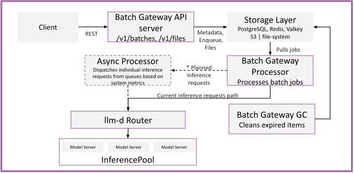

# Batch Gateway Architecture

Batch Gateway adds OpenAI-compatible batch inference processing to the llm-d stack. It sits between batch API clients and the llm-d Router, managing the lifecycle of batch jobs — from job creation through request dispatching to result collection.

  <picture>
    <source media="(prefers-color-scheme: dark)">
    
  </picture>

## API Server

The API server exposes OpenAI-compatible REST endpoints:

- `POST /v1/files` — Upload batch input files (JSONL format).
- `GET /v1/files` — List files.
- `GET /v1/files/{id}` — Retrieve file metadata.
- `GET /v1/files/{id}/content` — Download file content (input or output files).
- `DELETE /v1/files/{id}` — Delete a file.
- `POST /v1/batches` — Create a batch job referencing an uploaded input file.
- `GET /v1/batches/{id}` — Get job status, progress counts, and output file IDs.
- `POST /v1/batches/{id}/cancel` — Cancel a running job.
- `GET /v1/batches` — List batch jobs.

The API server validates input-file constraints. PostgreSQL stores job and file metadata, the job priority queue, events, and status. Input and output files use the configured filesystem or S3-compatible backend. With `dispatchMode=async`, the processor also uses an llm-d-async request/result queue backed by Redis/Valkey sorted sets.

## Batch Processor

The processor is the core execution engine. It:

1. **Polls** the priority queue for the next job.
2. **Ingests** the input file — parses model IDs and system prompts, groups requests by model, and builds per-model execution plans.
3. **Executes** plans concurrently — launches per-model goroutines, sends individual inference requests to the llm-d Router with concurrency limits, and writes results to an output file.
4. **Updates** the job status during processing, and listens to job events, such as cancellation.
5. **Finalizes** — uploads the output file and updates the job status.

### Concurrency Control

The processor uses two-level concurrency control to prevent overloading the llm-d Router:

- **Global concurrency** — caps total in-flight requests across all models.
- **Per-model concurrency** — caps in-flight requests to a single model.

### Crash Recovery

Every batch uses the resumable pipeline. The processor checkpoints completed request results to file storage and tracks batch ownership with a fenced PostgreSQL lease. If a processor is lost or its lease expires, the GC reconciler requeues the batch; another processor resumes from committed checkpoints and retries unfinished requests. This works with both synchronous and asynchronous dispatch; `dispatchMode` selects only the request transport. See the component's [resumable batch jobs design](https://github.com/llm-d/llm-d-batch-gateway/blob/main/docs/design/resumable-jobs.md) for details.

## Storage Layer

PostgreSQL stores core job state; file storage and optional async request queues are selected separately:

| Function | Options | Notes |
| -------- | ------- | ----- |
| Job and file metadata, job priority queue, events, status | PostgreSQL | Required core database |
| Async inference request/result queue | Redis/Valkey sorted sets | Used only with `dispatchMode=async` |
| File storage | Shared filesystem (RWX PVC), S3-compatible storage | Select the backend through the Helm values |

## Garbage Collector

The GC runs on a configurable interval and removes:

- Expired batch jobs (past their `completion_window`).
- Expired files (past their configured expiration).

It limits concurrent deletions to avoid database pressure.

## Authentication and Multi-Tenancy

Batch Gateway delegates authentication and authorization to an upstream gateway or auth proxy:

- By default, the API server reads tenant identity from the `X-MaaS-Username` header. It does not authenticate credentials; a trusted auth proxy must authenticate callers and inject this header.
- Do not expose the API server directly to clients. Direct access bypasses the authentication proxy and lets callers choose the tenant header.
- All data queries are filtered by tenant ID. Cross-tenant access is rejected.
- The processor forwards selected request headers with each inference request, so the llm-d Router can authenticate and authorize the end user per request.
- File paths are hashed by tenant ID to prevent enumeration.

With an auth proxy, the batch route authenticates the caller while the inference route can authorize access to each model. This lets batch submission remain separate from per-model authorization, which is enforced during inference.

## Observability

- **Prometheus metrics**: request counts, job processing times, queue wait duration, worker utilization, per-model concurrency, and token counts.
- **OpenTelemetry tracing**: distributed traces across API server, processor, database, and llm-d Router calls.
- **Grafana dashboards**: pre-built dashboards cover API server, processor, and GC metrics.
- **Prometheus alerting rules**: configurable alerts for high queue wait time, job failure rate, expired jobs, and worker saturation.

## Related

- [Batch Gateway Deployment Guide](../../../guides/batch-serving/batch-gateway) — deployment instructions, configuration options, and usage.
- [Batch Gateway Repository](https://github.com/llm-d/llm-d-batch-gateway) — source code, Helm chart, deployment and usage guides.
- [Batch Gateway Design Documents](https://github.com/llm-d/llm-d-batch-gateway/tree/main/docs/design) — detailed design documents.
- [Async Processor](async-processor.md) — composes with Batch Gateway for gated request dispatching.
