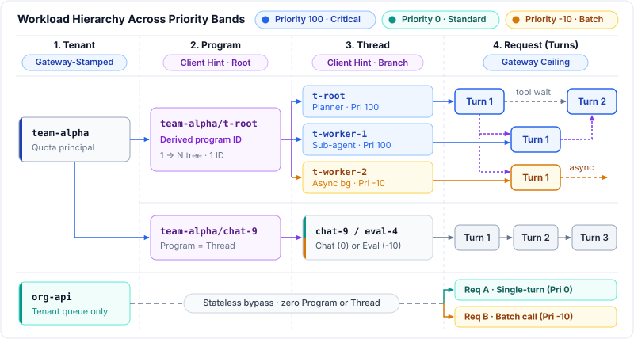
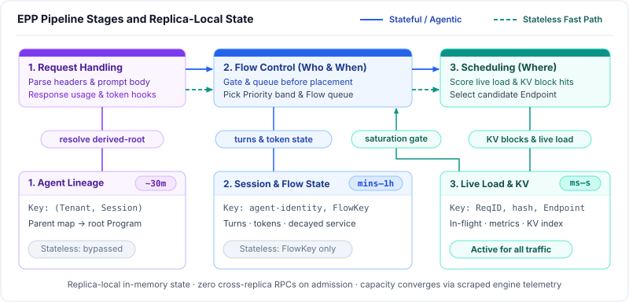

# Workload and State Model

When multiple users, applications, and agent harnesses share an `InferencePool`, traffic arrives with heterogeneous operational requirements. Workloads mix single-turn stateless API calls, multi-turn chat sessions, parallel multi-agent trees where a root session forks worker sub-agents, and multi-turn batch evaluation jobs.

To queue, prioritize, and place this traffic without cross-tenant interference or sub-agent queue amplification, the [Endpoint Picker (EPP)](epp.md) models traffic across a four-level workload hierarchy and three replica-local state domains.

> [!NOTE]
> By default, the EPP runs with Flow Control disabled and routes each request independently using content-hashed `prefix-cache-scorer` and endpoint load scorers. Priority queues, `<tenant>/<program>` lineage composition, and trajectory-aware fairness require `featureGates: [flowControl]` and opt-in plugins (`--allow-experimental-plugins` for alpha plugins such as `agent-identity`, `agent-lineage`, `session-state-producer`, and `weighted-fair-share-fairness-policy`; `program-aware-fairness` is beta); see [EPP Configuration](configuration.md).

---

## 1. Workload Hierarchy, Priority, and Trust

A flat per-request model cannot distinguish an independent single-turn call from a coding agent that forks parallel sub-agents across tool pauses. The EPP organizes requests into four conceptual levels:

<p align="center">
  <picture>
    
  </picture>
</p>

* **Level 1 — `Tenant` (Quota Scope)**: Represents the authenticated user, team, organization, or API key (`x-llm-d-inference-fairness-id`). Unlabeled requests map to the shared `default-flow` bucket.
* **Level 2 — `Program` (Root Workflow Scope)**: Represents a user task or root agent workflow. When `t-root` forks sub-agents (`t-worker-1`, `t-worker-2`), `agent-lineage` resolves each branch to `derived-root`. With `requestHandler.composeFairnessIDs: true`, the EPP composes `FairnessID` as `<tenant>/<program>` (`team-alpha/t-root`), collapsing a `1 → N` tree into one `FlowKey` per band while separating concurrent sessions (`team-alpha/chat-9`).
* **Level 3 — `Thread` (Sequential Branch and Session Scope)**: Represents an individual sequential conversation or worker branch (`agent-identity`, or `x-session-id` for session affinity) accumulating turns and tokens. For single-user chat or multi-turn batch evaluations, `Program` and `Thread` coincide.
* **Level 4 — `Request` (Single Inference Turn)**: A single inference call arriving at the EPP with a prompt and token budget, tracked by `RequestID`. Stateless calls attach directly from `Tenant` to `Request` with zero `Program` or `Thread` state.
* **Priority Bands (`InferenceObjective`)**: Orthogonal integer tiers (`100` Critical, `0` Standard, `-10` Batch and sheddable) across the hierarchy. Multi-turn batch evaluations (such as SWE-bench) carry full trajectories in negative bands. Within a multi-agent `Program`, sub-agents that a parent turn blocks on (`t-worker-1`) run in the parent's band to avoid priority inversion across the join, while async branches (`t-worker-2`) can target a lower band.

### KV Prefix Locality vs. Session Identity

Content-addressed prefix caching operates independently of session or lineage headers:

* Standard `/v1/chat/completions` clients resend conversation history on every turn. The `prefix-cache-scorer` plugin (`approx-prefix-cache-producer` or `precise-prefix-cache-producer`) hashes prompt token blocks directly from the request payload. Prompt hashing accelerates single-turn stateless requests, shared system prompts, and Turn 1 of newly forked sub-agents without requiring a session identifier.
* Explicit session and lineage headers are required only for Flow Control queue accounting (`<tenant>/<program>` grouping and trajectory fairness) or when the serving engine retains unshared server-side state across turns, such as in-memory OpenAI Responses API state (`/v1/responses` with `previous_response_id` without an upstream rehydration store) or opaque payloads routed via `session-affinity-scorer`.

### Ingress Trust Boundary

Because HTTP headers carry both cross-tenant resource entitlements and intra-tenant session lineage, deployments enforce an asymmetric trust boundary at the ingress gateway:

* **Gateway-Stamped (Cross-Tenant Entitlements)**: The gateway must strip untrusted external values of `x-llm-d-inference-fairness-id` and `x-llm-d-inference-objective` upstream of Envoy `ext_proc`. The gateway stamps the authenticated tenant identity into `x-llm-d-inference-fairness-id` and clamps `x-llm-d-inference-objective` to the caller's authorized tier ceiling.
* **Non-Empty Tenant Stamping**: Gateways fronting untrusted clients must stamp a non-empty fairness identifier (such as `anonymous`) on every request. If a gateway strips the fairness header without stamping a fallback value, the tenant remains unset and the EPP Director falls back to client-supplied session attributes even when `composeFairnessIDs` is `false`, allowing unauthenticated session IDs to mint separate flow queues or collide with stamped tenant IDs.
* **Client and Harness Hints (Intra-Tenant Lineage and Tightening)**: Session and lineage headers (`x-parent-session-id`, `x-opencode-session-id`, `x-claude-code-session-id`, `session-id`) and per-request queue-wait tightening (`x-llm-d-inference-ttl`) pass through from clients or agent harnesses. Within an authenticated tenant, these hints subdivide workflow queues or tighten per-request bounds without escalating tenant priority.

A canonical trace illustrates this boundary:

```text
Ingress Gateway stamps:  x-llm-d-inference-fairness-id: team-alpha
Agent harness sends:     x-opencode-session-id: t-worker-1, x-parent-session-id: t-root
EPP Director derives:    FairnessID = team-alpha/t-root
```

See [EPP HTTP Headers Reference](../../api-reference/epp-http-headers.md) for per-harness headers, deprecated alias stripping, and fallback resolution rules.

---

## 2. Three Decoupled State Domains: Who & When vs. Where

The EPP separates workload tracking into three independent data domains that communicate through request attributes on `InferenceRequest`:

<p align="center">
  <picture>
    
  </picture>
</p>

### Who & When vs. Where

The EPP decouples dispatch ordering and timing from candidate endpoint placement:

* **Flow Control (*Who & When*)**: Evaluates whether the pool has available serving capacity before committing a request to an endpoint, holding requests in upstream queues when saturated and arbitrating which priority band and tenant or program flow dispatches next.
* **Request Scheduling (*Where*)**: Executes once Flow Control dispatches the request, evaluating filter and scorer plugins against live endpoint telemetry and resident KV block indexes to pick the best endpoint.

### Incompatible Clocks and Replica-Local State

Lineage relationships span `~30m` tool-call pauses, session trajectory metrics decay over minutes to an hour, and live endpoint load changes on millisecond ticks.

All three domains reside in replica-local memory with zero cross-replica RPCs on the admission path. Multi-replica EPP instances converge on pool state through continuous metric scraping (`metrics-data-source`), KV event streams, and optional asynchronous peer state sync (`redis-syncer`). Stateless requests bypass Domain 1 and per-session tracking in Domain 2, incurring zero session allocation overhead.

| State Domain | Runtime Keys | State & Typical Window | Primary EPP Plugins | Stateless Traffic Path |
| :--- | :--- | :--- | :--- | :--- |
| **1. Agent Lineage** | `(Tenant, Session)` | In-memory parent fork map (`~30m`) resolving branches to root `derived-root` | `agent-lineage`, `agent-identity` | Bypassed (no lineage lookup or table write) |
| **2. Session & Flow State** | `agent-identity`, `FlowKey` (`FairnessID`) | Raw session turn/token counters (`SessionState`) and per-flow decayed service or virtual-time token ledgers (`mins–1h`) | `session-state-producer`, `program-aware-fairness`, `weighted-fair-share-fairness-policy` | Uses `<tenant>` `FlowKey`; `session-state-producer` bypassed |
| **3. Live Load & KV Index** | `RequestID`, prompt hash, `Endpoint` | In-flight requests, scraped engine metrics, and KV block index (`ms–s`) | `inflight-load-producer`, `approx-prefix-cache-producer`, `prefix-cache-scorer`, `utilization-detector` | Active for all traffic via prompt hash and load metrics |

`session-state-producer` publishes raw per-session facts (`TurnsTaken`, `InFlightRequests`, `LastResponseAt`, `TotalInputTokens`, `TotalOutputTokens`, `TotalCachedTokens`) via `SessionStateDataKey` for session-aware consumers. Flow Control fairness policies maintain per-flow (`FlowKey`) ledgers: decayed token service in `program-aware-fairness` (`las`) and virtual-time token cost in `weighted-fair-share-fairness-policy`. See [Flow Control Fairness Policies](flow-control.md#fairness-policies) for policy mechanics.

---

## 3. Workload Archetypes to EPP Controls

The following table summarizes how the EPP coordinates Flow Control, endpoint placement, and overload protection for common traffic patterns:

| Workload Archetype | Flow Control (Who & When) | Endpoint Placement (Where) | Behavior Under Saturation |
| :--- | :--- | :--- | :--- |
| **Stateless API / Single-Turn Batch** | Direct `<tenant>` queue; lineage and session tracking bypassed | Content-addressed prefix scoring on prompt hashes; load-balancing scorers | Buffered in tenant queue or dropped if negative priority |
| **Interactive Multi-Turn Chat** | Grouped by `<tenant>/<session>`; prioritized by Least Attained Service or Turn Priority | KV prefix cache affinity reuses resident context across turns | Higher priority bands preserve low Time to First Token |
| **Parallel Multi-Agent Tree** | Sub-agents collapse into one `<tenant>/<program>` ID per band instead of `N` separate queues | Turn 1 hits root KV cache via prefix hash; workers place across candidate endpoints | Blocking sub-agents run in parent band; async branches shed first in lower bands |
| **Multi-Turn Batch Evaluation** | Negative priority band buffers in background queues without starving standard traffic | Content-hashed KV prefix reuse across evaluation turns | Queue drains during off-peak periods; shed first under peak load |

---

## Related Documentation

* **[Endpoint Picker (EPP)](epp.md)**: Routing engine architecture, plugin interfaces, and request processing lifecycle.
* **[Request Handling](request-handling.md)**: Request parsing, header extraction, and attribute propagation.
* **[Flow Control](flow-control.md)**: Priority queuing, `SaturationDetector`, and fair-share queue topologies.
* **[Request Scheduling](scheduling.md)**: Filter, Scorer, and Picker plugin pipeline.
* **[Data Layer](datalayer.md)**: Endpoint discovery, metric scrapers, and prefix cache index.
* **[EPP Configuration](configuration.md)**: Declarative YAML configuration schema and plugin setup.
* **[Turn-Priority and Fairness Guide](../../../guides/turn-priority-fairness/README.md)**: Configuring `program-aware-fairness` (`las` and `turn-priority`) with `InferenceObjective` priority tiers.
* **[EPP HTTP Headers Reference](../../api-reference/epp-http-headers.md)**: Specification of supported wire headers, gateway trust rules, and configuration options.
