# Google Cloud TPU

**Tensor Processing Units (TPUs)** are Google-designed accelerators for the dense matrix math in neural networks. Google runs its own models on them, including Gemini and Veo, and offers them on Google Cloud. llm-d supports TPUs as a serving target: the router (EPP), `InferencePool`, Gateway API integration and OpenAI-compatible API are the same as on any other accelerator, and the model server is **vLLM** running on a TPU backend.

This page covers three things:

1. [TPU fundamentals](#1-tpu-fundamentals): how a TPU is built and the terms that appear in every manifest
2. [Engine support](#2-engine-support-torch-tpu): how vLLM runs on TPU through **Torch TPU**
3. [llm-d on TPU](#3-llm-d-on-tpu): which well-lit paths and model guides are available, and what a TPU deployment on GKE looks like

For GKE cluster setup (node pools, dynamic slicing, Gateway) see the [GKE provider page](../README.md).

## 1. TPU fundamentals

### Architecture

A TPU chip puts most of its silicon into a few large matrix units and relies on the **XLA compiler** to schedule work onto them. The main parts:

* **TensorCore**: the compute engine, built around matrix-multiply units (MXUs) plus vector and transpose units. v6e has one per chip; TPU7x has two, one per chiplet.
* **SparseCore**: a smaller co-processor for embedding lookups and other gather/scatter work, so irregular memory access doesn't stall the TensorCore. v6e has 2 per chip; TPU7x has 4 (2 per chiplet).
* **HBM**: holds weights and KV cache. For decode, capacity and bandwidth usually matter more than peak FLOPs.
* **ICI (inter-chip interconnect)**: direct chip-to-chip links forming a torus. Chips joined by ICI form a **slice**, the unit you schedule.
* **Host**: the CPU VM the chips attach to over PCIe. On GKE it is the node, and its DRAM can hold offloaded KV cache.
* **Secondary storage**: a shared ReadWriteMany filesystem reachable from the host over the network (for example [Google Cloud Managed Lustre](../../../../../guides/tiered-prefix-cache/manifests/backends/lustre/README.md)). It is the third KV-cache tier behind HBM and host DRAM: slower than both, but shared by every replica and persistent across pod restarts, so a prefix computed once can be reused by any pod.

*TPU7x (Ironwood) chip, simplified. Figures from the [TPU7x docs](https://cloud.google.com/tpu/docs/tpu7x).*

### Chip, device, slice

Three terms appear in every manifest and engine flag:

| Term | Meaning | Where it appears |
| --- | --- | --- |
| **Chip** | One physical TPU package. On TPU7x a chip holds **two chiplets (dies)**; on v6e, one. | `google.com/tpu: N` in the pod's resource request counts chips |
| **Device** | What the framework sees: one device per TensorCore, i.e. **one per die**. A v6e chip is one device; a TPU7x chip is two. | `--tensor-parallel-size` and `--data-parallel-size` in the `vllm serve` arguments of the model-server Deployment / LeaderWorkerSet patch count devices (for example [`optimized-baseline/modelserver/tpu/v7/vllm/base/patch-vllm.yaml`](../../../../../guides/optimized-baseline/modelserver/tpu/v7/vllm/base/patch-vllm.yaml)) |
| **Slice** | Chips joined by ICI, with a fixed shape (the **topology**) | `cloud.google.com/gke-tpu-accelerator` and `cloud.google.com/gke-tpu-topology` node selectors. One slice per replica |

On TPU7x the two chiplets of a chip share a **die-to-die ICI link that is about 6× faster than the ICI between neighbouring chips** ([dual-chiplet architecture](https://docs.cloud.google.com/tpu/docs/tpu7x#dual-chiplet_architecture)), so a model sharded across the two devices of one chip pays less for tensor-parallel collectives than one sharded across chips. The runtime still exposes the two dies as two separate devices with 96 GB of HBM each.

**Examples.** The engine's `TP × DP` must equal the number of devices in the slice, otherwise part of the slice stays idle:

| Machine type | Node selectors | Pod request | Chips | Devices | `vllm serve` parallelism |
| --- | --- | --- | --- | --- | --- |
| `ct6e-standard-4t` (v6e, one host) | `gke-tpu-accelerator: tpu-v6e-slice`, `gke-tpu-topology: 2x2` | `google.com/tpu: 4` | 4 | 4 | `--tensor-parallel-size=4` |
| `ct6e-standard-8t` (v6e, one host) | `tpu-v6e-slice`, `2x4` | `google.com/tpu: 8` | 8 | 8 | `--tensor-parallel-size=8` (the Foundations guides' v6e configuration) |
| `tpu7x-standard-4t` (TPU7x, one host) | `tpu7x`, `2x2x1` | `google.com/tpu: 4` | 4 | **8** | `--data-parallel-size=8 --tensor-parallel-size=1` for MoE models with expert parallelism, or `--tensor-parallel-size=8` |
| `tpu7x-standard-4t` × 2 (TPU7x, two hosts) | `tpu7x`, `2x2x2` | `google.com/tpu: 4` per pod | 8 | 16 | `--tensor-parallel-size=16`, or `--data-parallel-size=16 --tensor-parallel-size=1`; one pod per host, started together via LeaderWorkerSet |

In a multi-host slice, ICI carries traffic between hosts; the VPC network is used only for request traffic and, in P/D setups, KV transfer over DCN.

### Generations

| Per chip | TPU v6e (Trillium) | TPU7x (Ironwood) |
| --- | --- | --- |
| Peak compute | 918 TFLOPs BF16 (FP8 at the same rate) | 2,307 TFLOPs BF16 · 4,614 TFLOPs FP8 |
| HBM | 32 GB, 1,638 GB/s | 192 GB, 7,380 GB/s |
| TensorCores / SparseCores | 1 / 2 | 2 / 4 |
| Devices seen by the framework | 1 | 2 |
| ICI bandwidth (bidirectional) | 800 GB/s, 2D torus | 1,200 GB/s, 3D torus |
| DCN bandwidth | 100 Gb/s | 100 Gb/s |
| GKE machine types | `ct6e-standard-1t / -4t / -8t` | `tpu7x-standard-1t / -4t` |
| Max chips per slice | 256 | 9,216 |

Source: [TPU v6e](https://cloud.google.com/tpu/docs/v6e) · [TPU7x](https://cloud.google.com/tpu/docs/tpu7x)

**Sizing.** BF16 weights take about 2 GB per billion parameters, FP8 about 1 GB. The smallest single-host slice that holds the weights plus the KV cache you need is usually the right starting point: v6e `2x2` = 128 GB, v6e `2x4` = 256 GB, one TPU7x chip = 192 GB, TPU7x `2x2x1` = 768 GB. v6e suits small and mid-size models (the llm-d guides run `Qwen/Qwen3-32B` on it); TPU7x's per-chip memory and native FP8 fit large MoE checkpoints on a single host (the guides run `Qwen/Qwen3.5-397B-A17B-FP8`). Tensor parallelism inside a slice stays on ICI; llm-d scales out by adding replicas behind the EPP.

Learn more: [TPU system architecture](https://cloud.google.com/tpu/docs/system-architecture-tpu-vm) · [TPUs in GKE](https://cloud.google.com/kubernetes-engine/docs/concepts/tpus)

## 2. Engine support: Torch TPU

The request path is open source from the router down to the compiler; GKE is the managed layer underneath.

| Layer | Projects |
| --- | --- |
| Router and gateway | [llm-d](https://github.com/llm-d/llm-d), [Gateway API Inference Extension](https://github.com/kubernetes-sigs/gateway-api-inference-extension) (`InferencePool`, EPP), Envoy |
| Orchestration | Kubernetes, [LeaderWorkerSet](https://github.com/kubernetes-sigs/lws), [Kueue](https://kueue.sigs.k8s.io/) for dynamic slicing |
| Serving engine | **vLLM on Torch TPU** ([`vllm-torchtpu`](https://github.com/vllm-project/vllm-torchtpu), [docs](https://vllm-torchtpu.readthedocs.io/en/latest/), image [`vllm/vllm-torchtpu`](https://hub.docker.com/r/vllm/vllm-torchtpu)) · SGLang on Torch TPU ([`sglang-torchtpu`](https://github.com/sgl-project/sglang-torchtpu)) · JAX-based alternatives: [vLLM TPU](https://github.com/vllm-project/tpu-inference) (via Torchax), [SGL-JAX](https://github.com/sgl-project/sglang-jax) |
| Framework | **Torch TPU** ([`torch_tpu`](https://github.com/google-pytorch/torch_tpu), [PyTorch on TPU](https://docs.cloud.google.com/tpu/docs/pytorch-on-tpu)) · [JAX](https://github.com/jax-ml/jax) · [Torchax](https://github.com/google/torchax) · Pallas TPU kernels |
| Compiler | [OpenXLA](https://github.com/openxla/xla) |

Each layer helps improve performance (throughput, latency, cost) for a different part of the request path: the router through placement and cache affinity, the engine through batching and kernels, the compiler through fused TPU programs.

**Torch TPU** ([`google-pytorch/torch_tpu`](https://github.com/google-pytorch/torch_tpu); see [PyTorch on TPU](https://docs.cloud.google.com/tpu/docs/pytorch-on-tpu) in the Cloud TPU docs) runs PyTorch directly on TPU, without a JAX layer in between.
vLLM keeps its upstream model definitions, scheduler and APIs; the TPU-specific parts are the attention and MoE kernels, the KV-cache connectors and the compilation path. **vllm-torchtpu** is the engine package built on it and is the stack every TPU overlay in the llm-d guides uses (the [`torch-tpu-vllm`](../../../../../guides/recipes/modelserver/components/images/torch-tpu-vllm/release/kustomization.yaml) image component, which pins the public [`vllm/vllm-torchtpu`](https://hub.docker.com/r/vllm/vllm-torchtpu) image).

SGLang also runs on Torch TPU through the [`sglang-torchtpu`](https://github.com/sgl-project/sglang-torchtpu) plugin (standalone recipes under [`benchmark/tpu/recipe`](https://github.com/sgl-project/sglang-torchtpu/tree/main/benchmark/tpu/recipe)); the llm-d TPU overlays in this repository are vLLM. In addition to the PyTorch backends, TPU also supports JAX backends: **vLLM TPU** runs vLLM's PyTorch model code through Torchax, and **SGL-JAX** is a JAX port of [SGLang](https://github.com/sgl-project/sglang).

**What the engine supports on TPU.** The engine's interface is unchanged: the same `vllm serve` CLI, OpenAI API and `vllm:*` metrics. vLLM on TPU supports most of the popular engine-level features, such as prefix caching, chunked prefill and P/D disaggregation with KV transfer over DCN, as well as KV-cache offload to host memory, LoRA, multimodal inputs and speculative decoding. Quantized checkpoints load from Hugging Face as FP8 on TPU7x and INT8 / AWQ INT4 on v6e.

For model and feature status on Torch TPU see the [vLLM-TorchTPU documentation](https://vllm-torchtpu.readthedocs.io/en/latest/) (the JAX backend's [support matrix](https://github.com/vllm-project/tpu-inference#tpu-support-matrix-dashboard) and [recommended models](https://docs.vllm.ai/projects/tpu/en/latest/recommended_models/) are separate); each llm-d guide states the exact image, model and flags it was validated with.
Standalone (non-llm-d) vLLM-TorchTPU deployments for Ironwood and Trillium are in the [AI Hypercomputer TPU recipes](https://github.com/AI-Hypercomputer/tpu-recipes/tree/main/inference) (`inference/ironwood/vLLM/vLLM-TorchTPU`, `inference/trillium/vLLM/vLLM-TorchTPU`).

**Compilation.** XLA compiles the model for a fixed set of input-shape buckets at startup, which takes minutes for a large model. A persistent compile cache lets restarts and new replicas skip most of it; budget for the cold case in `startupProbe`. Details are in each guide's TPU notes.

## 3. llm-d on TPU

### Recipes

Every TPU recipe lives in a well-lit path or model guide and states the model, slice, image and flags it was run with:

| Guide | Use it when | TPU v6e | TPU7x |
| --- | --- | --- | --- |
| [Optimized baseline](../../../../../guides/optimized-baseline/README.md) | Always start here. One model server per slice behind the EPP | ✅ `Qwen/Qwen3-32B`, `2x4` TP=8 | ✅ `Qwen/Qwen3.5-397B-A17B-FP8`, `2x2x1` · ✅ [dynamic slicing](../README.md#tpu-dynamic-slicing-on-gke) (`tpu/v7-dynamic-slice`) |
| [P/D disaggregation](../../../../../guides/pd-disaggregation/README.md) | Prefill and decode need to scale separately: long prompts with short outputs, or strict TPOT targets | ✅ `Qwen/Qwen3-32B`, 1P + 1D, `TPUConnector` | ✅ `Qwen/Qwen3.5-397B-A17B-FP8`, prefill PCP=8 → decode DP=8 over TPU Sync with prefill host KV offload · ✅ dynamic slicing (`DisaggregatedSet`) |
| [Precise prefix-cache routing](../../../../../guides/precise-prefix-cache-routing/README.md) | Many requests share long prefixes: system prompts, multi-turn chat, RAG | ✅ `Qwen/Qwen3-32B` | ✅ `Qwen/Qwen3.5-397B-A17B-FP8` |
| [Tiered prefix cache](../../../../../guides/tiered-prefix-cache/README.md) | Prefix hit rate is limited by HBM; spill KV to host DRAM or shared storage | ✅ `Qwen/Qwen3-32B`, TPU Sync host tier | ✅ `Qwen/Qwen3.5-397B-A17B-FP8`, host-DRAM tier (`2x2x1`, and `2x2x2` multi-host) and a Managed Lustre filesystem tier (single-host); the [Qwen3.5-397B model guide](../../../../../guides/models/qwen3-5-397b/README.md) uses the host-DRAM tier |
| [Multimodal serving](../../../../../guides/multimodal-serving/README.md) | Vision-language models | — | ✅ `Qwen/Qwen3-VL-32B-Instruct`, `google/gemma-4-31B-it`, `Qwen/Qwen3.5-397B-A17B-FP8` |
| Router-only paths ([flow control](../../../../../guides/flow-control/README.md), [multi-model routing](../../../../../guides/multi-model-routing/README.md)) | Overload protection, many models behind one endpoint. Accelerator-independent | ✅ | ✅ |

**End-to-end recipe for agentic workloads.** The [Qwen3.5-397B model guide](../../../../../guides/models/qwen3-5-397b/README.md) composes the paths above — prefix-aware routing, tiered prefix cache (host DRAM KV offload), TPU Sync P/D disaggregation, MTP speculative decoding and tool calling — into one optimized configuration for agentic code generation on TPU7x, with the benchmark harness used to measure it. [GLM-5.2](../../../../../guides/models/glm-5-2/README.md) has a TPU7x deployment as well.

**Monitoring and tuning.** [Monitor GKE TPUs](../../../../operations/observability/tpu.md) adds TPU duty-cycle and HBM metrics next to the `vllm:*` dashboards. Performance numbers for each configuration are published in the guide that produced them, with the model, slice, image and benchmark setup. To start without llm-d, [AI-Hypercomputer/tpu-recipes](https://github.com/AI-Hypercomputer/tpu-recipes/tree/main/inference) has public vLLM-on-TPU recipes behind GKE Inference Gateway.

### Deploying on GKE

A TPU pod describes the slice it needs with two node selectors (accelerator and topology) plus a chip count. All three must agree with the node's machine type, or the pod stays `Pending` without a clear error. The table lists the settings that are TPU-specific in an llm-d model-server manifest; everything else (Gateway, HTTPRoute, `InferencePool`, EPP, OpenAI API, `vllm:*` metrics) is standard llm-d.

| Setting | v6e `2x4` | TPU7x `2x2x1` |
| --- | --- | --- |
| `cloud.google.com/gke-tpu-accelerator` | `tpu-v6e-slice` | `tpu7x` |
| `cloud.google.com/gke-tpu-topology` | `2x4` | `2x2x1` (one host) · `2x2x2` (two hosts, LeaderWorkerSet) · omitted with [dynamic slicing](../README.md#tpu-dynamic-slicing-on-gke), where Kueue places the slice |
| Resource request | `google.com/tpu: 8` | `google.com/tpu: 4` (8 devices) |
| Parallelism | TP × DP = 8 | TP × DP = 8 (see [§1](#chip-device-slice)) |
| Container image | [`vllm/vllm-torchtpu:v0.29.0`](https://hub.docker.com/r/vllm/vllm-torchtpu) via the `torch-tpu-vllm` image component | same |
| Checkpoints | Hugging Face; INT8 / AWQ INT4 | Hugging Face; FP8 |
| Model weights on disk | Node cache (`hostPath /var/cache/huggingface`, the `gke-model-cache-hostpath` component): downloaded once per node, kept across pod restarts. Boot disk ≥ 200 GB for Qwen3-32B | same; ≥ 1 TB for the 406 GB Qwen3.5-397B checkpoint |
| Startup | Weight load + XLA compile. Persist the compile cache; size `startupProbe` for the cold case | same |
| P/D KV transfer | Over DCN, 100 Gb/s per chip | same; TPU Sync over ICI inside a slice |
| Capacity | Custom ComputeClass: reservation → spot → DWS flex-start; node auto-provisioning creates the pool | same; or a pre-provisioned TPU7x sub-block with dynamic slicing |

Flex-start nodes run for at most **7 days** and are then preempted, so don't rely on them alone for a long-running service; check region availability and quota first. The device plugin is built into GKE.

For multi-host slices, deploy with LeaderWorkerSet so all hosts are created, scheduled and restarted together. For TPU7x capacity provisioned as `4x4x4` sub-blocks, use [dynamic slicing with Kueue](../README.md#tpu-dynamic-slicing-on-gke) and the `tpu/v7-dynamic-slice` overlays of the optimized-baseline and P/D guides. The guides' TPU notes also cover boot-disk sizing for weight downloads, the cluster-autoscaler `safe-to-evict` annotation and Artifact Registry access for the image.

Learn more: [Plan TPUs in GKE](https://cloud.google.com/kubernetes-engine/docs/concepts/plan-tpus) · [Deploy TPU workloads](https://cloud.google.com/kubernetes-engine/docs/how-to/tpus) · [Custom ComputeClasses](https://cloud.google.com/kubernetes-engine/docs/concepts/about-custom-compute-classes) · [DWS flex-start](https://cloud.google.com/kubernetes-engine/docs/concepts/dws) · [LeaderWorkerSet](https://github.com/kubernetes-sigs/lws)

## Learn more

* **llm-d:** [well-lit paths](https://llm-d.ai/docs/well-lit-paths) · [GKE provider page](../README.md) · [Qwen3.5-397B on TPU7x](../../../../../guides/models/qwen3-5-397b/README.md) · [Monitor GKE TPUs](../../../../operations/observability/tpu.md)
* **Torch TPU:** [vLLM-TorchTPU](https://github.com/vllm-project/vllm-torchtpu) · [vLLM-TorchTPU docs](https://vllm-torchtpu.readthedocs.io/en/latest/) · [`vllm/vllm-torchtpu` image](https://hub.docker.com/r/vllm/vllm-torchtpu) · [torch_tpu](https://github.com/google-pytorch/torch_tpu) · [PyTorch on TPU (Cloud TPU docs)](https://docs.cloud.google.com/tpu/docs/pytorch-on-tpu) · [AI Hypercomputer TPU recipes](https://github.com/AI-Hypercomputer/tpu-recipes/tree/main/inference) · [SGLang on Torch TPU](https://github.com/sgl-project/sglang-torchtpu) ([recipes](https://github.com/sgl-project/sglang-torchtpu/tree/main/benchmark/tpu/recipe))
* **JAX engines:** [vLLM TPU docs](https://docs.vllm.ai/projects/tpu/en/latest/) · [tpu-inference](https://github.com/vllm-project/tpu-inference) · [SGLang](https://github.com/sgl-project/sglang) · [SGL-JAX](https://github.com/sgl-project/sglang-jax)
* **TPUs on GKE:** [TPUs in GKE](https://cloud.google.com/kubernetes-engine/docs/concepts/tpus) · [Dynamic slicing](https://docs.cloud.google.com/kubernetes-engine/docs/concepts/dynamic-slicing) · [Custom ComputeClasses](https://cloud.google.com/kubernetes-engine/docs/concepts/about-custom-compute-classes) · [DWS flex-start](https://cloud.google.com/kubernetes-engine/docs/concepts/dws) · [GKE Inference Gateway](https://cloud.google.com/kubernetes-engine/docs/concepts/about-gke-inference-gateway)
* **Community:** [llm-d Slack](https://llm-d.ai/slack) · [vllm-torchtpu issues](https://github.com/vllm-project/vllm-torchtpu/issues) · [tpu-inference issues](https://github.com/vllm-project/tpu-inference/issues)
