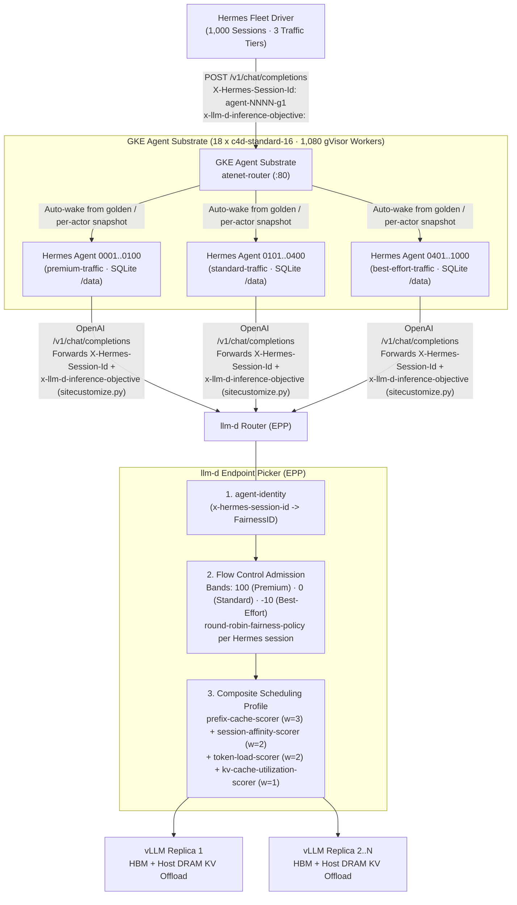

# Serve 1,000+ Stateful Agent Sandboxes with GKE Agent Substrate and llm-d

> [!NOTE]
> **Guide Tier:** Deployable Integration Guide · **Reference Demo:** [PyTorch Conference `ai-on-gke/llm-d-demo`](https://github.com/ai-on-gke/llm-d-demo)
> **Validated Reference Stack:** 1,000 [Hermes Agent](https://github.com/NousResearch/hermes-agent) gVisor sandboxes on GKE Agent Substrate (`18 × c4d-standard-16` CPU nodes) backed by `llm-d` Router + `vLLM` with Host-DRAM KV offloading on NVIDIA GPUs or Cloud TPU v7x (Ironwood).

## Overview

Long-horizon AI agents do not behave like stateless single-turn chat clients. Across a 1,000-agent fleet, each agent alternates between bursts of multi-turn LLM reasoning and long idle periods waiting on tools, code execution, or human input, while carrying a growing conversation prefix (`4k → 64k+` tokens) and local filesystem/SQLite session state.

Running 1,000 stateful agents against a naive Kubernetes deployment hits four compounding bottlenecks:

1. **Idle sandbox waste and cold-wake spikes**: Keeping 1,000 agent containers resident wastes ~90% of CPU and RAM during think/tool pauses, while cold-starting Python agent frameworks on demand adds ~3.4 s of setup CPU per agent and overwhelms node CPUs during simultaneous bursts.
2. **Broken KV locality after sandbox pause/resume**: When a paused agent wakes 30–300 seconds later, round-robin or queue-only routing lands its next turn on a different model server replica—forcing full prompt prefill recomputation and stranding KV blocks that were offloaded to the previous replica's Host DRAM.
3. **1,000-agent wake-storm hotspots**: Scraped Prometheus queue gauges lag behind millisecond-scale bursts. Without real-time in-flight prompt token accounting, a sudden 1,000-agent wake storm piles onto a single replica with a warm system prompt and blows up Time to First Token (TTFT).
4. **Cross-tier head-of-line blocking**: Background batch swarms and runaway tool loops flood model server queues, starving latency-sensitive interactive user sessions.

This guide reproduces the architecture from the [PyTorch Conference Agent Substrate × `llm-d` demo](https://github.com/ai-on-gke/llm-d-demo) end to end, pairing **GKE Agent Substrate** (sub-second gVisor memory + rootfs snapshots for 1,000 stateful **Hermes Agents**) with **`llm-d` session-aware routing, prefix-cache and token-load balancing, Host-DRAM KV tiering, and multi-tier priority Flow Control**.

### Reference Benchmark Highlights

Measured across 1,000 stateful Hermes Agent sandboxes (`NousResearch/hermes-agent`, SQLite session state under `/data/.hermes`) on `18 × c4d-standard-16` GKE nodes driving `vLLM` behind `llm-d`:

| Metric | Naive Baseline | Agent Substrate + `llm-d` | Mechanism |
| --- | --- | --- | --- |
| First-turn sandbox setup | `3,400 ms` | **`110 ms`** (`31×` faster) | Pre-warmed golden gVisor snapshot (`warmup.py` before `:8081/ready`) |
| Wake all 1,000 paused agents | Minutes (CPU thrash) | **`2.44 – 2.85 s`** (`0` failed) | Node-local gVisor checkpoint restore (`~56` agents/node) |
| Active sandbox footprint at 100 req/s | `100%` (`1,000` pods) | **`~9.2%` active (`90.8%` idle)** | Auto-wake on `atenet-router` ingress; zero-CPU pause between turns |
| Stateful session recall across pauses | Lost without external DB | **`99.99%`** (`14,679 / 14,681`, up to 28 pauses) | `SNAPSHOT_CONTENT_SCOPE_FULL` preserves memory + SQLite `/data/.hermes` |
| Multi-turn KV cache hit rate & TTFT | `<15%` hit rate | **`80%+` hit rate (`2–4×` lower TTFT)** | `session-affinity-scorer` + `prefix-cache-scorer` + `token-load-scorer` + Host-DRAM KV offload |
| Interactive tier p95 TTFT under burst | Collapses with batch queue | **Flat interactive p95 TTFT** | `flowControl` bands (`100` / `0` / `-10`) + `agent-identity` per-session fairness |

---

## Architecture



### How the Optimizations Fit Together

1. **Hermes Session Identity (`X-Hermes-Session-Id`) End-to-End**:
   - Callers send `X-Hermes-Session-Id: agent-NNNN-g<gen>` and `x-llm-d-inference-objective: <tier>` to each Hermes Agent sandbox over `atenet-router`.
   - Inside each sandbox, Hermes uses `X-Hermes-Session-Id` to load its SQLite conversation history (`/data/.hermes`), while [`sitecustomize.py`](./hermes/actor/sitecustomize.py) propagates both `X-Hermes-Session-Id` and `x-llm-d-inference-objective` directly onto the outbound `/v1/chat/completions` request to the `llm-d` Router (and short-circuits `agent-warmup` turns in-process during golden-snapshot creation so zero TCP sockets are frozen into the gVisor checkpoint).
2. **Router Session Awareness (`agent-identity` + `session-affinity-scorer`)**:
   - `agent-identity` (`additionalSessionHeaders: ["x-hermes-session-id"]`) runs before Flow Control admission and publishes `X-Hermes-Session-Id` as the `"agent-identity"` request attribute, which the EPP Director automatically uses as the request's flow-control `FairnessID`.
   - `session-affinity-scorer` (`strategy: session_id`, `evictionTtlSeconds: 900`) records a 15-minute `session_id -> replica` binding. When a paused Hermes sandbox resumes minutes later—after its HBM KV blocks have been evicted into that replica's **Host CPU DRAM**—`session-affinity-scorer` steers the session back to the exact replica holding its offloaded KV blocks instead of cold-prefilling elsewhere.
3. **Prefix-Cache + Real-Time Token-Load Scoring (`prefix-cache-scorer` + `token-load-scorer`)**:
   - On Turn 1 (unbound session), `session-affinity-scorer` is neutral (`0` on all pods). `prefix-cache-scorer` (`weight: 3`) prefers pods with the shared Hermes system prompt (`AGENTS.md`, ~700 tokens) cached, while `token-load-scorer` (`weight: 2`, fed by `inflight-load-producer`) tracks *real-time in-flight uncached prompt tokens* so a 1,000-agent wake storm spreads evenly across replicas immediately without waiting for Prometheus scrape intervals.
   - Because `session-affinity-scorer` is a soft weighted scorer (`weight: 2`) rather than a hard filter, overloaded pods naturally shed excess bursts onto idle replicas once in-flight token load rises.
4. **Multi-Tier Flow Control (`InferenceObjective` Priority Bands `100` / `0` / `-10`)**:
   - [`objectives.yaml`](./objectives.yaml) defines three priority tiers mapped to EPP `priorityBands`:
     - `premium-traffic` (`priority: 100`): interactive, user-facing Hermes agents (`maxRequests: "1k"`).
     - `standard-traffic` (`priority: 0`): standard multi-turn Hermes agents (`maxRequests: "500"`).
     - `best-effort-traffic` (`priority: -10`): background batch swarms (`maxRequests: "200"`, queued behind `100` and `0` and shed first when saturated).
   - Within every band, `round-robin-fairness-policy` interleaves per-session queues keyed by `X-Hermes-Session-Id`, preventing a single chatty agent loop from monopolizing its tier.

---

## Prerequisites

- **`kubectl`**, **`helm`** (`v3.14+`), **`kustomize`**, **`envsubst`** (`gettext`), **`openssl`**, and **`python3`** (`3.10+`).
- **Accelerator capacity for `llm-d` model servers**:
  - **NVIDIA GPU (default below)**: `2+` replicas × `2× H100 / A100 80 GB` GPUs (`TP=2`) with `>= 320 GiB` host RAM per pod for native CPU KV offloading, **or**
  - **Google Cloud TPU v7x (Ironwood)**: `2+` replicas × `tpu7x` (`2x2x1`, `TP=8`) with `TPUOffloadConnector` Host-DRAM KV offloading (shown in [Step 2](#2-deploy-the-model-server-with-host-dram-kv-offloading)).
- **For the full 1,000-sandbox GKE Agent Substrate deployment** ([Steps 5–7](#5-build-the-pre-warmed-hermes-agent-sandbox-image)):
  - A GKE cluster with **GKE Agent Substrate** (`ate-system` control plane, `atenet-router`, and gVisor `RuntimeClass`) and the `kubectl-ate` plugin installed.
  - Dedicated CPU node pool for the 1,000 Hermes sandboxes: `18 × c4d-standard-16` (`16 vCPU`, `64 GB` RAM, `100 GB` `hyperdisk-balanced`), labeled `pool=hermes,ate.dev/substrate-version=v0.1.0-gke.1` and tainted `ate.dev/sandboxClass=hermes:NoSchedule`.
  - A GCS bucket (`SNAPSHOT_BUCKET`) for `ActorTemplate` snapshots and an Artifact Registry repository (`HERMES_IMAGE_REPO`) for the digest-pinned Hermes actor image.

### Clone the Repository and Configure Environment

<!-- guide:prerequisites.clone start -->
<!-- llm-d-cicd:skip start -->
```bash
export BRANCH=main # branch, tag, or commit hash
git clone https://github.com/llm-d/llm-d.git && cd llm-d && git checkout ${BRANCH}
```
<!-- llm-d-cicd:skip end -->
<!-- guide:prerequisites.clone end -->

Export the guide environment variables and source [`guides/env.sh`](../env.sh):

<!-- guide:env.static start -->
```bash
export REPO_ROOT=$(realpath $(git rev-parse --show-toplevel))
export GUIDE_NAME=agent-substrate
export NAMESPACE=llm-d-agent-substrate
export MODEL_NAME=Qwen/Qwen3-32B
export INFRA_PROVIDER=gke # options: base, gke
export ROUTER_VALUES=${REPO_ROOT}/guides/${GUIDE_NAME}/router/${GUIDE_NAME}.values.yaml
export EXTRA_HELM_ARGS=
export ATESPACE=agent-hermes
export HERMES_AGENTS=1000
export HERMES_WORKER_REPLICAS=1080
export SUBSTRATE_VERSION=v0.1.0-gke.1
export SUBSTRATE_WORKER_IMAGE=us-docker.pkg.dev/gke-substrate-release/substrate/ateom-gvisor:v0.1.0-gke.1
export MONITORING=false # options: false, true
```
<!-- guide:env.static end -->

<!-- guide:env.source start -->
```bash
source ${REPO_ROOT}/guides/env.sh
```
<!-- guide:env.source end -->

### Install Gateway API Inference Extension and `llm-d` Router CRDs

Install the GAIE `InferencePool` CRDs and the `llm-d-router` `InferenceObjective` CRD:

<!-- guide:prerequisites.crds start -->
```bash
# GAIE_URL is calculated from GAIE_VERSION in ${REPO_ROOT}/guides/env.sh
kubectl apply -f https://github.com/kubernetes-sigs/gateway-api-inference-extension/${GAIE_URL}/v1-manifests.yaml

# ROUTER_RELEASE_URL is calculated from ROUTER_RELEASE_VERSION in ${REPO_ROOT}/guides/env.sh
kubectl apply -f https://github.com/llm-d/llm-d-router/${ROUTER_RELEASE_URL}/manifests.yaml
```
<!-- guide:prerequisites.crds end -->

### Create Namespace and Secrets

Create the target namespace, your Hugging Face token secret, and an ephemeral `hermes-api-key` secret (`>= 16` random hex bytes, never committed to Git):

<!-- guide:prerequisites.namespace start -->
```bash
kubectl create namespace ${NAMESPACE} --dry-run=client -o yaml | kubectl apply -f -
```
<!-- guide:prerequisites.namespace end -->

<!-- guide:prerequisites.secrets start -->
<!-- llm-d-cicd:skip start -->
```bash
export HF_TOKEN=<your HuggingFace token>
kubectl create secret generic llm-d-hf-token \
  --from-literal="HF_TOKEN=${HF_TOKEN}" \
  --namespace "${NAMESPACE}" \
  --dry-run=client -o yaml | kubectl apply -f -
```
<!-- llm-d-cicd:skip end -->
```bash
# Ephemeral bearer key shared between the fleet driver and the 1,000 Hermes sandboxes.
HERMES_API_KEY=$(openssl rand -hex 24)
kubectl create secret generic hermes-api-key \
  --from-literal="HERMES_API_KEY=${HERMES_API_KEY}" \
  --namespace "${NAMESPACE}" \
  --dry-run=client -o yaml | kubectl apply -f -
```
<!-- guide:prerequisites.secrets end -->

---

## Deployment

### 1. Deploy the `llm-d` Router

[`router/agent-substrate.values.yaml`](./router/agent-substrate.values.yaml) layers `agent-identity` (`x-hermes-session-id`), `session-affinity-scorer`, `approx-prefix-cache-producer`, `inflight-load-producer`, `prefix-cache-scorer`, `token-load-scorer`, and 3-band `flowControl` onto [`recipes/router/base.values.yaml`](../recipes/router/base.values.yaml).

#### Standalone Mode (In-Cluster EPP + Envoy Sidecar, Recommended for Same-Cluster Agent Substrate)

<!-- guide:deploy.standalone start -->
```bash
helm upgrade --install ${GUIDE_NAME} \
    ${ROUTER_STANDALONE_CHART} \
    -f ${REPO_ROOT}/guides/recipes/router/base.values.yaml \
    -f ${ROUTER_VALUES} \
    ${EXTRA_HELM_ARGS} \
    -n ${NAMESPACE} --version ${ROUTER_CHART_VERSION}
```
<!-- guide:deploy.standalone end -->

#### Gateway Mode (Kubernetes Gateway API Front Door)

<!-- guide:deploy.gateway start -->
```bash
export PROVIDER_NAME=gke # options: none, gke, agentgateway, istio
helm upgrade --install ${GUIDE_NAME} \
    ${ROUTER_GATEWAY_CHART} \
    -f ${REPO_ROOT}/guides/recipes/router/base.values.yaml \
    -f ${REPO_ROOT}/guides/recipes/router/features/httproute-flags.yaml \
    -f ${ROUTER_VALUES} \
    ${EXTRA_HELM_ARGS} \
    --set provider.name=${PROVIDER_NAME} \
    -n ${NAMESPACE} --version ${ROUTER_CHART_VERSION}
```
<!-- guide:deploy.gateway end -->

### 2. Deploy the Model Server with Host-DRAM KV Offloading

Hermes Agent requires a model context window of at least `64k` tokens (`--max-model-len=65536`). Render the [Tiered Prefix Cache](../tiered-prefix-cache/README.md) native CPU KV-offloading overlay, relabel it for `agent-substrate`, and set a `64k` context window:

<!-- guide:deploy.modelserver start -->
```bash
# Render tiered-prefix-cache's native Host-DRAM KV offloading overlay,
# relabel to this guide, and enable a 64k context window (required by Hermes Agent).
ROPE_OVERRIDE='{"rope_scaling":{"rope_type":"yarn","factor":2.0,"original_max_position_embeddings":32768},"max_position_embeddings":65536}'
kubectl kustomize ${REPO_ROOT}/guides/tiered-prefix-cache/modelserver/gpu/vllm/native/cpu/${INFRA_PROVIDER}/ \
  | sed "s/tiered-prefix-cache/${GUIDE_NAME}/g" \
  | sed "s|--shutdown-timeout=45|--max-model-len=65536 --hf-overrides '${ROPE_OVERRIDE}' --shutdown-timeout=45|g" \
  | kubectl apply -n ${NAMESPACE} -f -
```
<!-- guide:deploy.modelserver end -->

<details>
<summary><b>Alternative: Cloud TPU v7x (Ironwood) with <code>TPUOffloadConnector</code></b></summary>

To deploy on GKE Cloud TPU v7x (`TPUOffloadConnector` streaming evicted KV blocks between HBM and Host DRAM, as used in the PyTorch Conference demo), render the `tpu/v7` tiered-prefix-cache overlay instead:

```bash
ROPE_OVERRIDE='{"rope_scaling":{"rope_type":"yarn","factor":2.0,"original_max_position_embeddings":32768},"max_position_embeddings":65536}'
kubectl kustomize ${REPO_ROOT}/guides/tiered-prefix-cache/modelserver/tpu/v7/vllm/native/cpu/gke/ \
  | sed "s/tiered-prefix-cache/${GUIDE_NAME}/g" \
  | sed "s|--shutdown-timeout=45|--max-model-len=65536 --hf-overrides '${ROPE_OVERRIDE}' --shutdown-timeout=45|g" \
  | kubectl apply -n ${NAMESPACE} -f -
```

</details>

Wait for both the EPP deployment and the model server replicas to report `Available`:

<!-- guide:deploy.wait start -->
<!-- llm-d-cicd:skip start -->
```bash
kubectl wait --for=condition=Available deployment/${GUIDE_NAME}-epp -n ${NAMESPACE} --timeout=300s
kubectl wait --for=condition=Available deployment -l llm-d.ai/guide=${GUIDE_NAME},llm-d.ai/role=decode -n ${NAMESPACE} --timeout=1800s
```
<!-- llm-d-cicd:skip end -->
<!-- guide:deploy.wait end -->

*(Optional)* If Prometheus Operator is installed and `MONITORING=true`, apply the `PodMonitor`:

<!-- guide:deploy.monitoring start -->
```bash
# only when MONITORING=true:
kubectl apply -n ${NAMESPACE} -k ${REPO_ROOT}/guides/recipes/modelserver/components/monitoring
```
<!-- guide:deploy.monitoring end -->

### 3. Apply the Multi-Tier `InferenceObjective`s

Apply [`objectives.yaml`](./objectives.yaml) to register the three priority tiers (`premium-traffic` → `100`, `standard-traffic` → `0`, `best-effort-traffic` → `-10`):

<!-- guide:deploy.objectives start -->
```bash
kubectl apply -f ${REPO_ROOT}/guides/${GUIDE_NAME}/objectives.yaml -n ${NAMESPACE}
```
<!-- guide:deploy.objectives end -->

### 4. Deploy the In-Cluster Hermes Fleet Driver

Deploy [`manifests/hermes-driver.yaml`](./manifests/hermes-driver.yaml) and [`scripts/hermes_fleet_driver.py`](./scripts/hermes_fleet_driver.py), an in-cluster client pod that wakes and drives the 1,000 Hermes sandboxes through `atenet-router` across the three `InferenceObjective` priority tiers:

<!-- guide:deploy.driver start -->
```bash
kubectl create configmap hermes-fleet-driver-script \
  --from-file=hermes_fleet_driver.py=${REPO_ROOT}/guides/${GUIDE_NAME}/scripts/hermes_fleet_driver.py \
  -n ${NAMESPACE} --dry-run=client -o yaml | kubectl apply -f -
kubectl create configmap hermes-fleet-driver-config \
  --from-literal=LLMD_BASE_URL="http://${GUIDE_NAME}-epp.${NAMESPACE}.svc.cluster.local:80/v1" \
  --from-literal=MODEL_NAME="${MODEL_NAME}" \
  --from-literal=ATENET_ADDR="atenet-router.ate-system.svc.cluster.local:80" \
  --from-literal=ATESPACE="${ATESPACE}" \
  -n ${NAMESPACE} --dry-run=client -o yaml | kubectl apply -f -
kubectl apply -f ${REPO_ROOT}/guides/${GUIDE_NAME}/manifests/hermes-driver.yaml -n ${NAMESPACE}
kubectl wait --for=condition=Available deployment/hermes-fleet-driver -n ${NAMESPACE} --timeout=180s
```
<!-- guide:deploy.driver end -->

### 5. Build the Pre-Warmed Hermes Agent Sandbox Image

Build and push [`hermes/actor/`](./hermes/actor/) (`NousResearch/hermes-agent` pinned at commit `5ffbea8`, [`warmup.py`](./hermes/actor/warmup.py), and [`sitecustomize.py`](./hermes/actor/sitecustomize.py)), pinning `HERMES_IMAGE` by digest so every restored gVisor sandbox matches the golden snapshot:

<!-- guide:deploy.substrate_image start -->
<!-- llm-d-cicd:skip start -->
```bash
export HERMES_IMAGE_REPO="<region>-docker.pkg.dev/<project>/<repo>/agent-hermes"
docker build -t "${HERMES_IMAGE_REPO}:5ffbea8" ${REPO_ROOT}/guides/${GUIDE_NAME}/hermes/actor
docker push "${HERMES_IMAGE_REPO}:5ffbea8"
export HERMES_IMAGE="${HERMES_IMAGE_REPO}@$(gcloud artifacts docker images describe "${HERMES_IMAGE_REPO}:5ffbea8" --format='value(image_summary.digest)')"
```
<!-- llm-d-cicd:skip end -->
<!-- guide:deploy.substrate_image end -->

### 6. Deploy the GKE Agent Substrate `WorkerPool` and `ActorTemplate`

Provision the `18 × c4d-standard-16` node pool if not already present:

```bash
gcloud container node-pools create hermes-c4d-pool \
  --cluster="<your-gke-cluster>" --zone="<zone>" --project="<project>" \
  --machine-type=c4d-standard-16 --num-nodes=18 \
  --disk-type=hyperdisk-balanced --disk-size=100 \
  --node-labels=pool=hermes,ate.dev/substrate-version=${SUBSTRATE_VERSION} \
  --node-taints=ate.dev/sandboxClass=hermes:NoSchedule
```

Apply [`manifests/hermes-workerpool.yaml.tmpl`](./manifests/hermes-workerpool.yaml.tmpl) (`1,080` gVisor workers with `1536Mi` memory limit so the ~150 MiB checkpoint page cache never OOM-kills the gVisor sentry):

<!-- guide:deploy.substrate_pool start -->
<!-- llm-d-cicd:skip start -->
```bash
envsubst '${HERMES_WORKER_REPLICAS} ${SUBSTRATE_WORKER_IMAGE} ${SUBSTRATE_VERSION}' \
  < ${REPO_ROOT}/guides/${GUIDE_NAME}/manifests/hermes-workerpool.yaml.tmpl \
  | kubectl apply -f -
```
<!-- llm-d-cicd:skip end -->
<!-- guide:deploy.substrate_pool end -->

Create the `agent-hermes` `atespace` and register the `hermes-dense` `ActorTemplate` (`SNAPSHOT_CONTENT_SCOPE_FULL`, `1Gi` sandbox limit), pointing `MODEL_BASE_URL` directly at the `llm-d` Router (`LLMD_BASE_URL`) and piping the secret key into `kubectl ate` without writing it to disk:

<!-- guide:deploy.substrate_template start -->
<!-- llm-d-cicd:skip start -->
```bash
export SNAPSHOT_BUCKET="<your-gcs-snapshot-bucket>"
export LLMD_BASE_URL="http://${GUIDE_NAME}-epp.${NAMESPACE}.svc.cluster.local:80/v1"
HERMES_API_KEY=$(kubectl get secret hermes-api-key -n ${NAMESPACE} -o jsonpath='{.data.HERMES_API_KEY}' | base64 -d)
kubectl ate create atespace ${ATESPACE} || true
HERMES_API_KEY="${HERMES_API_KEY}" \
  envsubst '${HERMES_IMAGE} ${HERMES_API_KEY} ${LLMD_BASE_URL} ${MODEL_NAME} ${SNAPSHOT_BUCKET}' \
  < ${REPO_ROOT}/guides/${GUIDE_NAME}/manifests/hermes-template.yaml.tmpl \
  | kubectl ate create actor-template -f -
unset HERMES_API_KEY
```
<!-- llm-d-cicd:skip end -->
<!-- guide:deploy.substrate_template end -->

### 7. Wait for the Golden Snapshot and Create 1,000 Hermes Agents

**Always wait for the golden snapshot before creating or waking the 1,000 actors.** Substrate boots one seed sandbox, runs [`warmup.py`](./hermes/actor/warmup.py) (3 synthetic warmup turns answered in-process by [`sitecustomize.py`](./hermes/actor/sitecustomize.py)), and snapshots the warm Python + SQLite state once `:8081/ready` returns `200`:

<!-- guide:deploy.substrate_golden_wait start -->
<!-- llm-d-cicd:skip start -->
```bash
# Wait until GKE Agent Substrate captures the pre-warmed golden snapshot
# before creating the 1,000 actors so every sandbox restores warm (~110 ms).
until kubectl ate get actor-template -a ${ATESPACE} hermes-dense -o json \
  | python3 -c '
import json, sys
d = json.load(sys.stdin)
t = d.get("actorTemplates", [d])[0] if isinstance(d, dict) else d[0]
gs = ((t.get("status") or {}).get("goldenSnapshotStatus") or {}).get("goldenSnapshot") or {}
sys.exit(0 if gs.get("snapshotUri") else 1)
'; do
  echo "Waiting for hermes-dense golden snapshot..."
  sleep 5
done
echo "Golden snapshot ready."
```
<!-- llm-d-cicd:skip end -->
<!-- guide:deploy.substrate_golden_wait end -->

Instantiate all 1,000 Hermes Agent actors (`agent-0001` through `agent-1000`):

<!-- guide:deploy.substrate_actors start -->
<!-- llm-d-cicd:skip start -->
```bash
seq -f "agent-%04g" 1 ${HERMES_AGENTS} \
  | xargs -P 32 -I {} kubectl ate create actor -a ${ATESPACE} --template hermes-dense {}
```
<!-- llm-d-cicd:skip end -->
<!-- guide:deploy.substrate_actors end -->

---

## Verification

### Resolve the `llm-d` Endpoint

#### Standalone Mode

<!-- guide:verify.endpoint.standalone start -->
```bash
export IP=$(kubectl get service ${GUIDE_NAME}-epp -n ${NAMESPACE} -o jsonpath='{.spec.clusterIP}')
```
<!-- guide:verify.endpoint.standalone end -->

#### Gateway Mode

<!-- guide:verify.endpoint.gateway start -->
```bash
export IP=$(kubectl get gateway llm-d-inference-gateway -n ${NAMESPACE} -o jsonpath='{.status.addresses[0].value}')
```
<!-- guide:verify.endpoint.gateway end -->

### Check Router Flow-Control Initialization

Verify that the EPP started with the `flowControl` feature gate active:

<!-- guide:verify.tests.router_ready start -->
```bash
# Confirm EPP Flow Control and experimental agent-identity plugin loaded cleanly.
kubectl logs deploy/${GUIDE_NAME}-epp -c epp -n ${NAMESPACE} | grep "Initializing Flow Control layer"
```
<!-- guide:verify.tests.router_ready end -->

### Smoke-Check `llm-d` Session and Priority Headers

Verify that the `llm-d` Router and `vLLM` model servers accept a request carrying `X-Hermes-Session-Id` and `x-llm-d-inference-objective`:

<!-- guide:verify.tests.request start -->
```bash
# Smoke-check llm-d serving with X-Hermes-Session-Id and priority tier headers.
kubectl run curl-smoke --rm -i --restart=Never \
  --image=${CURL_TEST_IMAGE} \
  --namespace="${NAMESPACE}" \
  --env="IP=${IP}" \
  --env="MODEL_NAME=${MODEL_NAME}" \
  -- /bin/sh -c 'curl -fsS -X POST "http://${IP}/v1/chat/completions" \
    -H "Content-Type: application/json" \
    -H "X-Hermes-Session-Id: smoke-0001" \
    -H "x-llm-d-inference-objective: premium-traffic" \
    -d "{\"model\": \"${MODEL_NAME}\", \"messages\": [{\"role\": \"user\", \"content\": \"Say ready.\"}], \"max_tokens\": 16, \"chat_template_kwargs\": {\"enable_thinking\": false}}"'
```
<!-- guide:verify.tests.request end -->

### Drive 1,000 Hermes Agent Sandboxes End-to-End

Wake all 1,000 Hermes sandboxes simultaneously through `atenet-router` (`10%` `premium-traffic`, `30%` `standard-traffic`, `60%` `best-effort-traffic`), teach each agent its deterministic codename on Turn 1 (`X-Hermes-Session-Id: agent-NNNN-g1` + per-tier `x-llm-d-inference-objective`), and verify Turn-2 stateful recall:

<!-- guide:verify.tests.substrate_burst start -->
<!-- llm-d-cicd:skip start -->
```bash
# Wake all 1,000 Hermes sandboxes through atenet-router, teach each
# agent a deterministic codename on Turn 1, and verify multi-tier
# stateful session recall on Turn 2.
kubectl exec deploy/hermes-fleet-driver -n ${NAMESPACE} -- \
  python3 /opt/driver/hermes_fleet_driver.py \
    --agents ${HERMES_AGENTS} \
    --turns 2 \
    --concurrency 200
```
<!-- llm-d-cicd:skip end -->
<!-- guide:verify.tests.substrate_burst end -->

Expected progression across turns:

- **Turn 1**: All 1,000 sandboxes auto-wake from the pre-warmed golden gVisor snapshot (`~110 ms` first-turn setup), while `prefix-cache-scorer` reuses the shared `AGENTS.md` system prompt, `token-load-scorer` spreads the wake burst across `vLLM` replicas in real time, and Flow Control prioritizes `premium-traffic` (`100`) ahead of `standard-traffic` (`0`) and `best-effort-traffic` (`-10`).
- **Turn 2**: `session-affinity-scorer` routes each `X-Hermes-Session-Id` back to the replica holding its Turn-1 KV blocks, yielding lower E2E latency and near-100% codename `Recall`.

### Verify Stateful Memory and KV Affinity Across gVisor Pause/Resume

Pause a 50-agent cohort (`SNAPSHOT_CONTENT_SCOPE_FULL` checkpoints memory + `/data/.hermes` SQLite state and terminates the sandbox processes), then issue a new recall turn through `atenet-router`—which auto-wakes each sandbox from its snapshot and routes its LLM call back to its bound `llm-d` replica via `X-Hermes-Session-Id`:

<!-- guide:verify.tests.pause_resume_recall start -->
<!-- llm-d-cicd:skip start -->
```bash
# Pause a cohort of Hermes sandboxes to gVisor memory+rootfs snapshots,
# then trigger another recall turn through atenet-router (auto-waking
# from snapshot) to verify SQLite session persistence and session-affinity KV hits.
seq -f "agent-%04g" 1 50 \
  | xargs -P 25 -I {} kubectl ate pause actor -a ${ATESPACE} {}
kubectl exec deploy/hermes-fleet-driver -n ${NAMESPACE} -- \
  python3 /opt/driver/hermes_fleet_driver.py \
    --agents 50 \
    --turns 2 \
    --concurrency 50
```
<!-- llm-d-cicd:skip end -->
<!-- guide:verify.tests.pause_resume_recall end -->

### Inspect EPP Flow-Control, Session, and vLLM Prefix-Cache Metrics

Grant `/metrics` scrape RBAC to `hermes-fleet-driver` and inspect per-band queue depth, dispatch counts, and `agent-identity` per-session fairness resolution on `:9090/metrics`:

<!-- guide:verify.tests.metrics_rbac start -->
```bash
kubectl create clusterrole ${GUIDE_NAME}-metrics-reader \
    --verb=get --non-resource-url=/metrics \
    --dry-run=client -o yaml | kubectl apply -f -
kubectl create clusterrolebinding ${GUIDE_NAME}-metrics-reader \
    --clusterrole=${GUIDE_NAME}-metrics-reader \
    --serviceaccount=${NAMESPACE}:hermes-fleet-driver \
    --dry-run=client -o yaml | kubectl apply -f -
kubectl create clusterrolebinding ${GUIDE_NAME}-epp-auth-delegator \
    --clusterrole=system:auth-delegator \
    --serviceaccount=${NAMESPACE}:${GUIDE_NAME}-epp \
    --dry-run=client -o yaml | kubectl apply -f -
```
<!-- guide:verify.tests.metrics_rbac end -->

```bash
kubectl exec deploy/hermes-fleet-driver -n ${NAMESPACE} -- python3 -c '
import os, urllib.request
token = open("/var/run/secrets/kubernetes.io/serviceaccount/token").read().strip()
epp = os.environ["LLMD_BASE_URL"].split("/v1")[0].replace(":80", ":9090")
req = urllib.request.Request(epp + "/metrics", headers={"Authorization": "Bearer " + token})
for line in urllib.request.urlopen(req, timeout=10).read().decode().splitlines():
    if line.startswith(("llm_d_epp_flow_control_", "llm_d_epp_fairness_id_resolved_total")):
        print(line)
'
```

Look for `llm_d_epp_flow_control_queue_size` and `llm_d_epp_flow_control_request_queue_duration_seconds_count` labeled by `priority="100"`, `priority="0"`, and `priority="-10"`, along with `llm_d_epp_fairness_id_resolved_total{source="agent_identity"}` per `X-Hermes-Session-Id`: under saturation, queue depth accumulates in `priority="-10"` (`best-effort-traffic`) while `priority="100"` (`premium-traffic`) drains immediately.

Finally, inspect the ground-truth `vLLM` prefix-cache hit rate and Host-DRAM KV offload counters directly from each model server replica (streaming SSE chunks and Hermes's outer `/v1/chat/completions` wrapper omit `prompt_tokens_details.cached_tokens`, so `:8000/metrics` is the authoritative cache counter):

<!-- guide:verify.tests.prefix_cache_metrics start -->
```bash
# Inspect per-replica vLLM HBM prefix-cache hit rate and Host-DRAM KV offload counters.
for pod in $(kubectl get pods -n ${NAMESPACE} -l llm-d.ai/guide=${GUIDE_NAME},llm-d.ai/role=decode -o jsonpath='{.items[*].metadata.name}'); do
  echo "== ${pod}"
  kubectl get --raw "/api/v1/namespaces/${NAMESPACE}/pods/${pod}:8000/proxy/metrics" \
    | awk '
      /^vllm:prefix_cache_hits_total/ {h=$NF}
      /^vllm:prefix_cache_queries_total/ {q=$NF}
      /^vllm:kv_offload_.*_bytes_total/ {print "  " $0}
      END {printf "  HBM prefix-cache hit rate: %.1f%% (%.0f / %.0f tokens)\n", (q>0 ? 100*h/q : 0), h, q}
    '
done
```
<!-- guide:verify.tests.prefix_cache_metrics end -->

---

## Router and KV-Cache Tuning

### Choosing the Right Routing Profile for Agent Fleets

| Workload Pattern | Recommended Profile | Why It Helps |
| --- | --- | --- |
| **Stateful sandboxes with pause/resume + Host-DRAM KV offload (Default)** | [`router/agent-substrate.values.yaml`](./router/agent-substrate.values.yaml) (`prefix-cache-scorer` + `session-affinity-scorer` + `token-load-scorer`) | `session-affinity-scorer` (`X-Hermes-Session-Id`) remembers which pod holds a paused agent's Host-DRAM offloaded KV blocks even after approximate HBM LRU state ages out, while `token-load-scorer` prevents 1,000-agent wake storms from overloading one replica. |
| **High KV-eviction churn with vLLM ZMQ KV events** | Layer [`precise-prefix-cache-producer`](../precise-prefix-cache-routing/README.md) with `session-affinity-scorer` + `token-load-scorer` | Subscribes to vLLM ZMQ KV events (`:5556` / `:5559`) and tokenizes on the model servers (`token-producer`), giving `prefix-cache-scorer` and `inflight-load-producer` exact resident-block visibility when using a KV-events-enabled vLLM overlay. |
| **Stateless clients without a session ID header** | [Optimized Baseline](../optimized-baseline/README.md) (`prefix-cache-affinity-filter` + `token-load-scorer`) | Uses calibrated `peakPrefillThroughput` gating ("sticky until saturated"). Do **not** combine `prefix-cache-affinity-filter` with weighted `prefix-cache-scorer` or `session-affinity-scorer`, as weighted affinity scorers override the filter's load-break fallback. |
| **Deep variable-length agent loops competing in one batch tier** | Layer [`program-aware-fairness` (`turn-priority`)](../turn-priority-fairness/README.md) on `priority: -10` | Replaces `round-robin-fairness-policy` in the batch band so deeper multi-turn conversations finish and release KV blocks before newly started sessions enter the pool. |

### Sizing `maxConcurrency`

[`router/agent-substrate.values.yaml`](./router/agent-substrate.values.yaml) sets `maxConcurrency: 128` (`concurrencyMode: requests`) as a starting point for `2–4` vLLM replicas serving short-completion agent turns (`max_tokens: 48–64`). Re-derive `maxConcurrency` for your replica count, model size, and average prompt length using [Tune Flow Control Concurrency](../../docs/operations/traffic/flow-control-tuning.md).

---

## Troubleshooting

- **EPP pod crashes on startup with `plugin "agent-identity" is experimental`**: Ensure `router.epp.flags.allow-experimental-plugins: true` is present in your Helm values (included in [`router/agent-substrate.values.yaml`](./router/agent-substrate.values.yaml)).
- **Hermes Agent refuses to start or errors with context length `< 64k`**: Hermes enforces `context_length >= 65536`. Confirm both `CONTEXT_LENGTH: "65536"` on the `ActorTemplate` and `--max-model-len=65536` on the `vLLM` Deployment.
- **gVisor workers OOM-killed during `PauseActor`**: Check `dmesg` or pod `Last State: OOMKilled` on `hermes-workerpool`. Pausing a warm Hermes sandbox writes a `~150 MiB` checkpoint whose page cache is charged to the worker and sandbox cgroups; keep `ActorTemplate` memory at `1Gi` and `WorkerPool` memory limit at `1536Mi`.
- **Slow 1,000-agent wake (`> 5 s`) or `atenet-router` `HTTP 504`**: Verify that the golden snapshot (`goldenSnapshot.snapshotUri`) finished building *before* creating the 1,000 actors, and confirm `18+` `c4d-standard-16` nodes (`<= 60` agents/node) with `hyperdisk-balanced` boot disks so node I/O does not stall on concurrent snapshot reads. Do not retry `HTTP 504` responses from `atenet-router`, as a Hermes turn appends to SQLite and is non-idempotent.
- **All tiers share the same latency under overload**: Verify `kubectl get inferenceobjectives -n ${NAMESPACE}` shows `premium-traffic`, `standard-traffic`, and `best-effort-traffic`, and confirm `maxConcurrency` is lower than your burst concurrency so requests queue inside EPP Flow Control rather than inside vLLM's internal scheduler.

---

## Cleanup

Remove the 1,000 Agent Substrate actors, `ActorTemplate`, `atespace`, fleet driver, `InferenceObjective`s, `llm-d` Router release, model server deployment, and cluster-scoped metrics RBAC:

<!-- guide:cleanup start -->
<!-- llm-d-cicd:skip start -->
```bash
# Remove GKE Agent Substrate actors, ActorTemplate, atespace, and WorkerPool if deployed.
if kubectl ate get atespace ${ATESPACE} >/dev/null 2>&1; then
  seq -f "agent-%04g" 1 ${HERMES_AGENTS} \
    | xargs -P 32 -I {} kubectl ate delete actor -a ${ATESPACE} {} || true
  kubectl ate delete actor-template -a ${ATESPACE} hermes-dense || true
  kubectl ate delete atespace ${ATESPACE} || true
fi
kubectl delete namespace ${ATESPACE} --ignore-not-found=true
```
<!-- llm-d-cicd:skip end -->
```bash
kubectl delete -f ${REPO_ROOT}/guides/${GUIDE_NAME}/manifests/hermes-driver.yaml -n ${NAMESPACE} --ignore-not-found=true
kubectl delete configmap hermes-fleet-driver-script hermes-fleet-driver-config -n ${NAMESPACE} --ignore-not-found=true
kubectl delete secret hermes-api-key -n ${NAMESPACE} --ignore-not-found=true

helm uninstall ${GUIDE_NAME} -n ${NAMESPACE}

kubectl delete -f ${REPO_ROOT}/guides/${GUIDE_NAME}/objectives.yaml -n ${NAMESPACE} --ignore-not-found=true

kubectl kustomize ${REPO_ROOT}/guides/tiered-prefix-cache/modelserver/gpu/vllm/native/cpu/${INFRA_PROVIDER}/ \
  | sed "s/tiered-prefix-cache/${GUIDE_NAME}/g" \
  | kubectl delete -n ${NAMESPACE} -f - --ignore-not-found=true

# only when MONITORING=true:
kubectl delete -n ${NAMESPACE} -k ${REPO_ROOT}/guides/recipes/modelserver/components/monitoring --ignore-not-found=true

kubectl delete clusterrolebinding ${GUIDE_NAME}-metrics-reader ${GUIDE_NAME}-epp-auth-delegator --ignore-not-found=true
kubectl delete clusterrole ${GUIDE_NAME}-metrics-reader --ignore-not-found=true
```
<!-- llm-d-cicd:skip start -->
```bash
kubectl delete namespace ${NAMESPACE} --ignore-not-found=true
```
<!-- llm-d-cicd:skip end -->
<!-- guide:cleanup end -->
