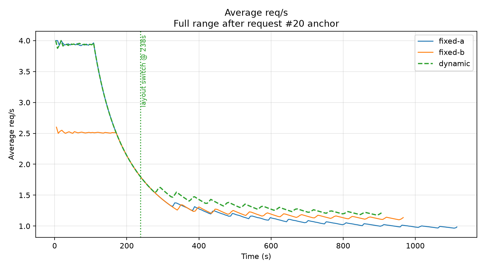

# Dynamic P/D Disaggregation

## Overview

> [!WARNING]
> This is an **experimental feature**. It is less mature and less tested than
> [P/D Disaggregation](../pd-disaggregation/README.md), its APIs and layout
> semantics may change, and it should not be treated as production-ready.

This guide changes the effective prefill and decode assignment of a symmetric
model-server pool at runtime. Participating workers belong to one role-transfer
group and share a model identity, accelerator class, and compatible KV-transfer
configuration. A pool may contain multiple tensor-parallel buckets; a worker
keeps its tensor-parallel size when it changes roles, and each bucket is
rebalanced independently. The role reassignment is implemented in the Router
and is not tied to a specific accelerator type.

The example starts with one prefill worker and two decode workers
(`p_1tp1_d_2tp1_m_none`) and changes to two prefill workers and one decode
worker (`p_2tp1_d_1tp1_m_none`). Dynamic P/D is opt-in and remains disabled in
other llm-d deployments.

## What You Get

Clients send requests to the Coordinator. For every request, the Coordinator
sends a prefill request and a decode request through the Gateway with an
`x-llm-d-epp-profile` header. The Router maps those profile names to runtime effective
roles and selects an eligible worker. Kubernetes role labels describe the
initial layout; changing the runtime layout does not modify labels or restart
workers.

The HTTPRoute in this guide only matches Coordinator requests containing
`x-llm-d-epp-profile`. Untagged client requests continue to the Coordinator route.

The bundled reference configuration uses three single-accelerator workers. KV
transfer remains configured on every worker so either role can produce or
consume transferred KV cache after a layout change.

The layout API stores state in EPP memory, so layout changes are lost when EPP
restarts. Do not expose the metrics/admin listener outside a trusted
administrative boundary.

### Supported Accelerators and Model Servers

The dynamic role-assignment mechanism is accelerator-independent, but this
guide currently includes one community-maintained reference configuration:

| Accelerator | `ACCELERATOR_TYPE` | Model server | Served model | Configuration |
| --- | --- | --- | --- | --- |
| Intel XPU | `xpu` | vLLM | `Qwen/Qwen3-0.6B` | Three single-XPU workers; NIXL with a direct XPU buffer over `tcp,ze_copy` |

Additional accelerators require an equivalent symmetric model-server overlay
whose workers can act as both KV producers and consumers. They are not covered
by this guide yet.

## Prerequisites

- Kubernetes with Gateway API and GAIE installed.
- Three accelerator devices supported by one of this guide's model-server
  overlays. The bundled Intel XPU configuration requires the Intel XPU DRA
  `DeviceClass` named `gpu.intel.com`.
- `helm`, `kubectl`, `kustomize`, `envsubst`, `curl`, and `jq`.
- `HF_TOKEN` for downloading the model.
- An EPP image built from an llm-d-router revision containing the experimental
  `dynamicPD` feature. The standard chart image must not be assumed to contain
  this feature until the corresponding Router change is merged and published.

## Build the Required EPP Image

Until `dynamicPD` is available in a published Router image, build and publish an
EPP image from the Router revision that contains the feature:

```bash
cd /path/to/llm-d-router

export EPP_IMAGE_REGISTRY=registry.example.com
export EPP_IMAGE_REPOSITORY=llm-d-router-endpoint-picker
export EPP_IMAGE_TAG=dynamic-pd-$(git rev-parse --short HEAD)

make image-build-epp \
  IMAGE_REGISTRY="${EPP_IMAGE_REGISTRY}" \
  EPP_IMAGE_NAME="${EPP_IMAGE_REPOSITORY}" \
  EPP_TAG="${EPP_IMAGE_TAG}"

docker push \
  "${EPP_IMAGE_REGISTRY}/${EPP_IMAGE_REPOSITORY}:${EPP_IMAGE_TAG}"
```

The image is suitable only if EPP recognizes the `dynamicPD` feature gate and
registers `/v1/layout/show` and `/v1/layout/change` when it is enabled.

## Deploy

From the llm-d checkout:

```bash
export REPO_ROOT=$(realpath $(git rev-parse --show-toplevel))
source "${REPO_ROOT}/guides/env.sh"
export GUIDE_NAME=dynamic-pd-disaggregation
export NAMESPACE=llm-d-dynamic-pd-disaggregation
export PROVIDER_NAME=istio
export ACCELERATOR_TYPE=xpu
export MODEL_SERVER=vllm
export MODEL=Qwen/Qwen3-0.6B
export INFRA_PROVIDER=base

kubectl create namespace "${NAMESPACE}" \
  --dry-run=client -o yaml | kubectl apply -f -
kubectl create secret generic llm-d-hf-token \
  --from-literal="HF_TOKEN=${HF_TOKEN}" \
  -n "${NAMESPACE}" --dry-run=client -o yaml | kubectl apply -f -

helm upgrade --install "${GUIDE_NAME}" "${ROUTER_GATEWAY_CHART}" \
  -f "${REPO_ROOT}/guides/recipes/router/base.values.yaml" \
  -f "${REPO_ROOT}/guides/recipes/router/features/httproute-flags.yaml" \
  -f "${REPO_ROOT}/guides/${GUIDE_NAME}/router/${GUIDE_NAME}.values.yaml" \
  --set provider.name="${PROVIDER_NAME}" \
  --set router.epp.image.registry="${EPP_IMAGE_REGISTRY}" \
  --set router.epp.image.repository="${EPP_IMAGE_REPOSITORY}" \
  --set router.epp.image.tag="${EPP_IMAGE_TAG}" \
  -n "${NAMESPACE}" --version "${ROUTER_CHART_VERSION}"

kubectl apply -n "${NAMESPACE}" \
  -k "${REPO_ROOT}/guides/${GUIDE_NAME}/router/httproute/base"
kubectl apply -n "${NAMESPACE}" \
  -k "${REPO_ROOT}/guides/${GUIDE_NAME}/modelserver/${ACCELERATOR_TYPE}/${MODEL_SERVER}/${INFRA_PROVIDER}"
```

Deploy the Coordinator with a P/D-only pipeline:

```bash
if [ "${PROVIDER_NAME}" = agentgateway ]; then
  export GATEWAY_ADDRESS="http://llm-d-inference-gateway.${NAMESPACE}.svc:80"
else
  export GATEWAY_ADDRESS="http://llm-d-inference-gateway-${PROVIDER_NAME}.${NAMESPACE}.svc:80"
fi

kustomize build "${REPO_ROOT}/guides/coord-disaggregation/coordinator/base" \
  | envsubst | kubectl apply -n "${NAMESPACE}" -f -
kubectl patch configmap llm-d-coordinator-config -n "${NAMESPACE}" \
  --type=strategic \
  --patch="$(envsubst < "${REPO_ROOT}/guides/${GUIDE_NAME}/coordinator/patch-pd-only.yaml")"
kubectl rollout restart deployment/llm-d-coordinator -n "${NAMESPACE}"
kubectl rollout status deployment/llm-d-coordinator \
  -n "${NAMESPACE}" --timeout=5m
```

## Verify

Send one request through the Coordinator so the role filters observe the
available workers and initialize the in-memory layout:

```bash
if [ "${PROVIDER_NAME}" = agentgateway ]; then
  export GATEWAY_SERVICE=llm-d-inference-gateway
else
  export GATEWAY_SERVICE=llm-d-inference-gateway-${PROVIDER_NAME}
fi
kubectl run curl-test --rm -i --restart=Never \
  --image="${CURL_TEST_IMAGE}" --namespace="${NAMESPACE}" \
  --env="MODEL=${MODEL}" --env="GATEWAY_SERVICE=${GATEWAY_SERVICE}" \
  -- /bin/sh -c 'curl -fsS -X POST "http://${GATEWAY_SERVICE}/v1/completions" -H "Content-Type: application/json" -d "{\"model\":\"${MODEL}\",\"prompt\":\"How are you today?\",\"max_tokens\":16}"'
```

The layout API shares the authenticated EPP metrics/admin listener. Access the
listener only through a local port-forward:

```bash
kubectl port-forward --address 127.0.0.1 -n "${NAMESPACE}" \
  "service/${GUIDE_NAME}-epp" 9090:9090
```

In another terminal, create a short-lived token for the dedicated layout-admin
ServiceAccount and change the layout:

```bash
export EPP_ADMIN_TOKEN=$(kubectl create token dynamic-pd-layout-admin \
  -n "${NAMESPACE}" --duration=15m)
curl -fsS -H "Authorization: Bearer ${EPP_ADMIN_TOKEN}" \
  http://127.0.0.1:9090/v1/layout/show | jq
curl -fsS -X POST http://127.0.0.1:9090/v1/layout/change \
  -H "Authorization: Bearer ${EPP_ADMIN_TOKEN}" \
  -H 'Content-Type: application/json' \
  -d '{"layout":"p_2tp1_d_1tp1_m_none"}' | jq
curl -fsS -H "Authorization: Bearer ${EPP_ADMIN_TOKEN}" \
  http://127.0.0.1:9090/v1/layout/show \
  | jq -e '.current_layout == "p_2tp1_d_1tp1_m_none"'
```

Send the same completion request again after the change. The change is valid
when inference succeeds, worker pod UIDs and restart counts remain unchanged,
and `/v1/layout/show` reports the requested layout.

## Performance and Accuracy Validation

The reference deployment used four single-XPU TP1 workers serving
`Qwen/Qwen3-8B` on Intel Arc Pro B60 devices. Each worker used `NixlConnector`
with an XPU KV buffer and RDMA transport. These results describe this environment
and are not portable performance claims.

A benchmark client ran two scenarios through the complete Gateway, Coordinator,
EPP, and model-server path. Scenario 1 used ISL/OSL 2000/150; Scenario 2 used
1000/1000. Fixed A kept the 2P/2D layout, Fixed B kept the 1P/3D layout, and the
dynamic policy changed from 2P/2D to 1P/3D between scenarios.

| Policy | Scenario 1 req/s | Scenario 2 req/s | Errors |
| --- | ---: | ---: | ---: |
| Fixed A | 3.7403 | 0.8017 | 0 |
| Fixed B | 2.4233 | 0.9995 | 0 |
| Dynamic | 3.7393 | 0.9987 | 0 |

Dynamic reached 99.97% and 99.92% of the best fixed-layout throughput in the
two scenarios without restarting workers.



The plot joins the independently launched scenarios on each policy's original
timeline. It includes successful profiling requests, excludes warmup requests,
and uses request 20 as the cumulative-average anchor.

For accuracy, `lm_eval` ran the full 1,319-example GSM8K task with 5-shot greedy
generation before and after changing from 2P/2D to 1P/3D.

| Layout | Exact match | Samples |
| --- | ---: | ---: |
| 2P/2D, before switch | 0.8961 | 1,319 |
| 1P/3D, after switch | 0.8969 | 1,319 |

Worker pod UIDs and restart counts remained unchanged during the switch.

## Cleanup

```bash
kubectl delete -n "${NAMESPACE}" \
  -k "${REPO_ROOT}/guides/${GUIDE_NAME}/modelserver/${ACCELERATOR_TYPE}/${MODEL_SERVER}/${INFRA_PROVIDER}"
kubectl delete -n "${NAMESPACE}" \
  -k "${REPO_ROOT}/guides/${GUIDE_NAME}/router/httproute/base"
kubectl delete -n "${NAMESPACE}" \
  -k "${REPO_ROOT}/guides/coord-disaggregation/coordinator/base"
helm uninstall "${GUIDE_NAME}" -n "${NAMESPACE}"
```
