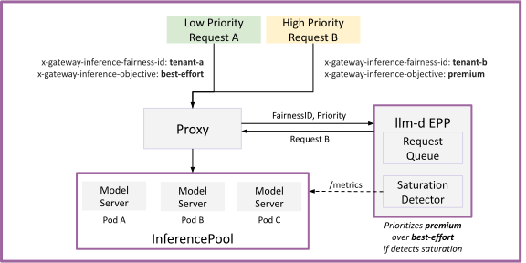
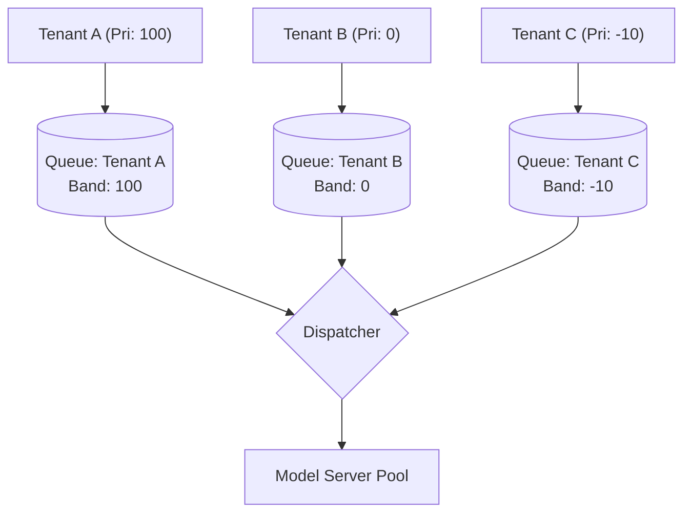
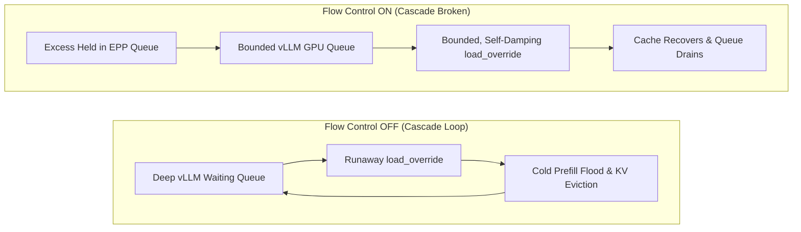

# Flow Control

[](https://github.com/llm-d/llm-d/actions/workflows/consolidate-status-flow-control-gke-acc-gpu-vllm-x.yaml)
[](https://github.com/llm-d/llm-d/actions/workflows/consolidate-status-flow-control-amd-ci-acc-rocm-vllm-x.yaml)

## Overview

Flow Control enables intelligent request queuing at the llm-d Router level. Traditional load balancing falls short for LLMs because resource consumption varies wildly per request. Shifting queuing to the Router enables:

* **Multi-Tenancy**: Prevent noisy neighbors from starving others and enforce fairness between tenants. Compared to a single-workload deployment, operators of multi-tenant workloads have additional considerations:
  * Certain tenants are **higher-priority** than others (e.g. paid vs unpaid).
  * Certain requests have **different SLOs** than others (e.g. batch vs online).
  * Certain tenants are more active than others, so **fairness** between them matters.
* **No-Regret Scheduling**: Hold requests during peak saturation instead of committing them to a server's local queue where they become stuck. By delaying dispatch until load subsides, the EPP ensures requests land on the best available resource and prevents prefix-cache cascading overload during partial outages (see [Use Case 3](#use-case-3-prefix-cache-cascade-protection)).

### How it Works

<p align="center">
  <picture>
    <source media="(prefers-color-scheme: dark)">
    
  </picture>
</p>

Requests arrive at the proxy with headers expressing their tenant ID and traffic priority. The EPP classifies each request by a `FlowKey` (Fairness ID + Priority), maintains separate in-memory queues for each flow, and assigns each flow to a `PriorityBand` (several tenants can share the same priority). In each scheduling cycle it dispatches based on:

1. **Priority**: Servicing highest priority bands first.
2. **Fairness**: Cycling through tenants within a band, as decided by the **Fairness Policy**.
3. **Ordering**: Ordering requests within a flow, as decided by the **Ordering Policy** (e.g. FCFS or SLO-aware).

In the background, the EPP monitors the model servers for saturation; while it detects saturation, requests stay queued until it subsides.

*While Backpressure protects the physical hardware from overload, the Multi-Tenancy policies dictate exactly how that delayed traffic is ordered and distributed among your users.*

The following diagram illustrates the centralized queuing topology:



## Default Configuration

The following default hardware configuration is inherited from the [Optimized Baseline](../optimized-baseline/README.md):

| Parameter          | Value                                                   |
| ------------------ | ------------------------------------------------------- |
| Model              | [Qwen/Qwen3-32B](https://huggingface.co/Qwen/Qwen3-32B) |
| Replicas           | 2                                                       |
| Tensor Parallelism | 2                                                       |
| GPUs per replica   | 2                                                       |
| Total GPUs         | 4                                                       |

When the `flowControl` feature gate is enabled, the EPP uses the following policies by default. These defaults are explicitly designed to mimic legacy, non-flow-control behavior (Strict FCFS) to ensure a seamless transition for existing workloads.

| Policy Type | Default Plugin | Description |
| :--- | :--- | :--- |
| **Fairness** | `global-strict-fairness-policy` | Ignores flow isolation and serves all requests in a single global order. |
| **Ordering** | `fcfs-ordering-policy` | First-Come, First-Served based on arrival time. |
| **Saturation** | `utilization-detector` | Closed-loop detector reacting to real-time telemetry. |

> [!NOTE]
>
> * Beneath the flow control layer, [router/flow-control.values.yaml](./router/flow-control.values.yaml) configures the EPP's standard prefix-cache and load-aware scorers (`prefix-cache-scorer`, `queue-scorer`, and `kv-cache-utilization-scorer`). Flow control acts as an intelligent ingress layer that holds saturated traffic *before* it passes to the scheduler.
> * While `utilization-detector` is the out-of-the-box system default listed here, production deployments should switch to `concurrency-detector` to avoid telemetry lag risks, as detailed in the [Tune Flow Control Concurrency](../../docs/operations/traffic/flow-control-tuning.md).

By default, the EPP uses a `global-strict` policy. Because the system is **work-conserving**, it will never artificially throttle traffic if GPUs have spare capacity. However, enforcing strict fairness (like Round-Robin) during periods of saturation constrains the scheduler's ability to pick the globally optimal request for batching or cache reuse, thereby bounding the maximum explorable latency-throughput frontier. The default prioritizes absolute global throughput, while this guide overrides it to prioritize tenant equity.

### Supported Hardware Backends

Flow Control is a software-level scheduling feature at the EPP layer and is entirely hardware-agnostic. It supports all accelerators detailed in the [Optimized Baseline guide](../optimized-baseline/README.md#supported-accelerators-and-model-servers). Since this guide builds exactly on top of that baseline, we will dynamically deploy the baseline's model servers in the steps below rather than maintaining duplicate configurations.

The steps below default to NVIDIA GPU. See the "AMD ROCm" and "Intel XPU" details under [Deploy the Model Server](#2-deploy-the-model-server) for other documented, dynamically-rendered paths. Other accelerators listed in the Optimized Baseline guide can be substituted the same way: swap the kustomize path in that step, then, if the target overlay's model or replica count differs from the [Default Configuration](#default-configuration) table above, adjust the benchmarking/verification steps accordingly.

## Prerequisites

* Have the [proper client tools installed on your local system](../../helpers/client-setup/README.md) to use this guide.
* Checkout llm-d repo:

<!-- guide:prerequisites.clone start -->
<!-- llm-d-cicd:skip start -->
```bash
export BRANCH=main # branch, tag, or commit hash
git clone https://github.com/llm-d/llm-d.git && cd llm-d && git checkout ${BRANCH}
```
<!-- llm-d-cicd:skip end -->
<!-- guide:prerequisites.clone end -->

* Set the guide environment variables:

<!-- guide:env.static start -->
```bash
export REPO_ROOT=$(realpath $(git rev-parse --show-toplevel))
export GUIDE_NAME=flow-control
export NAMESPACE=llm-d-flow-control
export MODEL_NAME=Qwen/Qwen3-32B
export INFRA_PROVIDER=base # options: base, gke
export ROUTER_VALUES=${REPO_ROOT}/guides/${GUIDE_NAME}/router/${GUIDE_NAME}.values.yaml
export EXTRA_HELM_ARGS=
export MONITORING=false # options: false, true
```
<!-- guide:env.static end -->

* Source the common guide environment variables:

<!-- guide:env.source start -->
```bash
source ${REPO_ROOT}/guides/env.sh
```
<!-- guide:env.source end -->

* Install the required CRDs (GAIE InferencePool + llm-d.ai InferenceObjective):

<!-- guide:prerequisites.crds start -->
```bash
# GAIE_URL is automatically calculated from GAIE_VERSION at ${REPO_ROOT}/guides/env.sh
kubectl apply -f https://github.com/kubernetes-sigs/gateway-api-inference-extension/${GAIE_URL}/v1-manifests.yaml

# ROUTER_RELEASE_URL is automatically calculated from ROUTER_RELEASE_VERSION at ${REPO_ROOT}/guides/env.sh
kubectl apply -f https://github.com/llm-d/llm-d-router/${ROUTER_RELEASE_URL}/manifests.yaml
```
<!-- guide:prerequisites.crds end -->

* Create a target namespace for the installation:

<!-- guide:prerequisites.namespace start -->
```bash
kubectl create namespace ${NAMESPACE} --dry-run=client -o yaml | kubectl apply -f -
```
<!-- guide:prerequisites.namespace end -->

* [Create the `llm-d-hf-token` secret in your target namespace with the key `HF_TOKEN` matching a valid HuggingFace token](../../helpers/hf-token.md) to pull models.

<!-- guide:prerequisites.secrets start -->
<!-- llm-d-cicd:skip start -->
```bash
export HF_TOKEN=<your HuggingFace token>
kubectl create secret generic llm-d-hf-token \
  --from-literal="HF_TOKEN=${HF_TOKEN}" \
  --namespace "${NAMESPACE}" \
  --dry-run=client -o yaml | kubectl apply -f -
```
<!-- llm-d-cicd:skip end -->
<!-- guide:prerequisites.secrets end -->

## Installation Instructions

### 1. Deploy the Router

**(Optional) Enable Prometheus monitoring on the router** (requires installing the [Monitoring stack](../../docs/operations/observability/setup.md) first; see [Enable monitoring](#3-enable-monitoring-optional)):

<!-- llm-d-cicd:skip start -->
```bash
export EXTRA_HELM_ARGS="--values=${REPO_ROOT}/guides/recipes/router/features/monitoring.values.yaml"
```
<!-- llm-d-cicd:skip end -->

#### Standalone Mode

This deploys the router with an Envoy sidecar, it doesn't set up a Kubernetes Gateway.

<!-- guide:deploy.standalone start -->
```bash
helm upgrade --install ${GUIDE_NAME} \
    ${ROUTER_STANDALONE_CHART} \
    -f ${REPO_ROOT}/guides/recipes/router/base.values.yaml \
    -f ${ROUTER_VALUES} \
    ${EXTRA_HELM_ARGS} \
    -n ${NAMESPACE} --version ${ROUTER_CHART_VERSION}
```
<!-- guide:deploy.standalone end -->

The router pod's resource requests are set in
[base.values.yaml](../recipes/router/base.values.yaml): 4 vCPU and 8 GiB of memory for
each of the EPP and Envoy containers, so 8 vCPU and 16 GiB per pod. A pod stuck `Pending`
with `Insufficient cpu` needs a node with the pod's full CPU request allocatable.

<details>
<summary><h4>Gateway Mode</h4></summary>

To use a Kubernetes Gateway managed proxy rather than the standalone version, follow these steps instead of applying the previous Helm chart:

1. *Deploy a Kubernetes Gateway* named `llm-d-inference-gateway` by following one of [the gateway guides](../../docs/infrastructure/gateway).
2. *Deploy the router and an HTTPRoute* that connects it to the Gateway as follows:

<!-- guide:deploy.gateway start -->
```bash
export PROVIDER_NAME=gke # options: none, gke, agentgateway, istio
helm upgrade --install ${GUIDE_NAME} \
    ${ROUTER_GATEWAY_CHART} \
    -f ${REPO_ROOT}/guides/recipes/router/base.values.yaml \
    -f ${REPO_ROOT}/guides/recipes/router/features/httproute-flags.yaml \
    -f ${ROUTER_VALUES} \
    ${EXTRA_HELM_ARGS} \
    --set provider.name=${PROVIDER_NAME} \
    -n ${NAMESPACE} --version ${ROUTER_CHART_VERSION}
```
<!-- guide:deploy.gateway end -->

</details>

### 2. Deploy the Model Server

Instead of maintaining duplicate hardware configurations, we dynamically render the model server manifests from the `optimized-baseline` guide and inject the `flow-control` guide labels using `sed`.

Deploy the model server (defaulting to NVIDIA GPU / vLLM) by running:

<!-- guide:deploy.modelserver start -->
```bash
kubectl kustomize ${REPO_ROOT}/guides/optimized-baseline/modelserver/gpu/vllm/${INFRA_PROVIDER}/ \
  | sed "s/optimized-baseline/${GUIDE_NAME}/g" \
  | kubectl apply -n ${NAMESPACE} -f -
```
<!-- guide:deploy.modelserver end -->

<details>
<summary><h4>AMD ROCm</h4></summary>

Flow Control also runs on the Optimized Baseline guide's AMD vLLM model server
(2 replicas, TP=2, `Qwen/Qwen3-32B` on AMD Instinct MI355X). Render the AMD
overlay and relabel it for this guide:

```bash
export INFRA_PROVIDER=base

kubectl kustomize ${REPO_ROOT}/guides/optimized-baseline/modelserver/amd/vllm/${INFRA_PROVIDER}/ \
  | sed "s/optimized-baseline/${GUIDE_NAME}/g" \
  | kubectl apply -n ${NAMESPACE} -f -
```

</details>

<details>
<summary><h4>Intel XPU</h4></summary>

Flow Control also runs on the Optimized Baseline guide's Intel XPU model server (2 × vLLM, one Intel Data Center GPU Max 1550+ per pod, `Qwen/Qwen3-0.6B`). Its CI runners are single-XPU-per-pod, so it does not carry the GPU path's TP=2 / `Qwen3-32B` configuration — the [Default Configuration](#default-configuration) table above does not apply as-is; use `Qwen/Qwen3-0.6B` and 2 replicas for this path instead. Override `MODEL_NAME` before deploying, since every verification/benchmark command below sends its request to `${MODEL_NAME}`, and the default (`Qwen/Qwen3-32B`) is not the model this overlay loads:

```bash
export MODEL_NAME="Qwen/Qwen3-0.6B"

kubectl kustomize ${REPO_ROOT}/guides/optimized-baseline/modelserver/xpu/vllm/ \
  | sed "s/optimized-baseline/${GUIDE_NAME}/g" \
  | kubectl apply -n ${NAMESPACE} -f -
```

</details>

Wait for the router deployment (`${GUIDE_NAME}-epp`) and the model server deployments (`-l llm-d.ai/guide=${GUIDE_NAME}`, e.g., `flow-control-nvidia-gpu-vllm-decode`) to become `Available` before continuing (`Qwen/Qwen3-32B` takes several minutes to download weights and compile graphs):

<!-- guide:deploy.wait start -->
<!-- llm-d-cicd:skip start -->
```bash
kubectl wait --for=condition=Available deployment/${GUIDE_NAME}-epp -n ${NAMESPACE} --timeout=300s
kubectl wait --for=condition=Available deployment -l llm-d.ai/guide=${GUIDE_NAME} -n ${NAMESPACE} --timeout=1800s
```
<!-- llm-d-cicd:skip end -->
<!-- guide:deploy.wait end -->

### 3. Enable monitoring (optional)

If you want Prometheus scraping via `ServiceMonitor` and `PodMonitor`, the [Monitoring stack](../../docs/operations/observability/setup.md) must be installed in the cluster so those CRDs exist:

* Set `export EXTRA_HELM_ARGS="--values=${REPO_ROOT}/guides/recipes/router/features/monitoring.values.yaml"` before running the [router installation command](#1-deploy-the-router) (or re-run `helm upgrade --install` with `EXTRA_HELM_ARGS` set if you already deployed the router without it).
* Set `export MONITORING=true` to deploy the monitoring resources (`PodMonitor`) for the model servers:

<!-- guide:deploy.monitoring start -->
```bash
# only when MONITORING=true:
kubectl apply -n ${NAMESPACE} -k ${REPO_ROOT}/guides/recipes/modelserver/components/monitoring
```
<!-- guide:deploy.monitoring end -->

## Verification

### 1. Get the IP of the Proxy

**Standalone Mode**

<!-- guide:verify.endpoint.standalone start -->
```bash
export IP=$(kubectl get service ${GUIDE_NAME}-epp -n ${NAMESPACE} -o jsonpath='{.spec.clusterIP}')
```
<!-- guide:verify.endpoint.standalone end -->

<details>
<summary> <b>Gateway Mode</b> </summary>

<!-- guide:verify.endpoint.gateway start -->
```bash
export IP=$(kubectl get gateway llm-d-inference-gateway -n ${NAMESPACE} -o jsonpath='{.status.addresses[0].value}')
```
<!-- guide:verify.endpoint.gateway end -->

</details>

### 2. Basic Verification

Check EPP logs for feature gate activation:

<!-- guide:verify.tests.feature_gate start -->
```bash
# -c epp: in standalone mode kubectl defaults to the Envoy sidecar, whose log never matches
kubectl logs deploy/${GUIDE_NAME}-epp -c epp -n ${NAMESPACE} | grep "Initializing Flow Control layer"
```
<!-- guide:verify.tests.feature_gate end -->

Expected: one line, `Initializing Flow Control layer`. No output means the gate is off for
this deployment (the EPP then logs `Flow Control layer is disabled` instead) or the log
format changed; the stronger check is that `llm_d_epp_flow_control_*` series exist on the
metrics endpoint (see [Proof of Queuing](#3-proof-of-queuing)).

### 3. Proof of Queuing

To fully verify that queuing and backpressure are working, you must apply concurrent load; [Use Case 2](#use-case-2-backpressure-management) does that with a burst of concurrent requests. For now, set up the test environment.

**Read `maxConcurrency` from [router/flow-control.values.yaml](./router/flow-control.values.yaml).**
The Use Case 2 load test sizes its burst from `MAX_CONCURRENCY`; a retuned values file
changes the burst with it:

<!-- guide:verify.tests.max_concurrency start -->
```bash
MAX_CONCURRENCY=$(awk '$1 == "maxConcurrency:" {print $2; n++} END {exit n!=1}' \
    ${ROUTER_VALUES}) \
  || echo "expected exactly one maxConcurrency: in the values file" >&2
export MAX_CONCURRENCY
echo "maxConcurrency: ${MAX_CONCURRENCY}"   # expect the integer set in the values file
```
<!-- guide:verify.tests.max_concurrency end -->

**Grant read access to the EPP metrics endpoint.** By default (`router.monitoring.prometheus.auth.enabled: true`), the EPP authenticates every metrics scrape against the Kubernetes API: a `TokenReview` on the caller's bearer token, then a `SubjectAccessReview` on the `/metrics` URL (note: if you enabled `monitoring.values.yaml` in [Step 1](#1-deploy-the-router), it sets `--metrics-endpoint-auth=false`, making the RBAC grants below a harmless no-op). While the Helm chart grants the EPP's service account (`${GUIDE_NAME}-epp`) permission to run those reviews, it only adds the `/metrics` reader rule when `router.monitoring.prometheus.enabled` is set (which also creates a `ServiceMonitor`), and binds it to `${GUIDE_NAME}-epp` rather than `default`. Grant the debug pod's `default` service account permission to read `/metrics` (and bind `system:auth-delegator` to `${GUIDE_NAME}-epp` as a fallback if chart RBAC was disabled):

<!-- guide:verify.tests.metrics_rbac start -->
```bash
kubectl create clusterrole ${GUIDE_NAME}-metrics-reader \
    --verb=get --non-resource-url=/metrics \
    --dry-run=client -o yaml | kubectl apply -f -
kubectl create clusterrolebinding ${GUIDE_NAME}-metrics-reader \
    --clusterrole=${GUIDE_NAME}-metrics-reader \
    --serviceaccount=${NAMESPACE}:default \
    --dry-run=client -o yaml | kubectl apply -f -
kubectl create clusterrolebinding ${GUIDE_NAME}-epp-auth-delegator \
    --clusterrole=system:auth-delegator \
    --serviceaccount=${NAMESPACE}:${GUIDE_NAME}-epp \
    --dry-run=client -o yaml | kubectl apply -f -
```
<!-- guide:verify.tests.metrics_rbac end -->

Without the `${GUIDE_NAME}-metrics-reader` grant (when metrics auth is enabled), the metrics endpoint returns `403 Forbidden`, and every metrics check in this guide reads as empty `grep` output.

**Open a temporary interactive shell inside the cluster:**

```bash
kubectl run curl-debug --rm -it \
    --image=${CURL_TEST_IMAGE} \
    --namespace="$NAMESPACE" \
    --env="IP=$IP" \
    --env="NAMESPACE=$NAMESPACE" \
    --env="GUIDE_NAME=$GUIDE_NAME" \
    --env="MODEL_NAME=$MODEL_NAME" \
    --env="MAX_CONCURRENCY=$MAX_CONCURRENCY" \
    -- /bin/bash
```

**From inside the debug pod, check the metrics.** The pod's automounted service account
token authenticates the scrape:

```bash
TOKEN=$(cat /var/run/secrets/kubernetes.io/serviceaccount/token)
curl -s -o metrics.txt -w "%{http_code}\n" -H "Authorization: Bearer ${TOKEN}" \
  http://${GUIDE_NAME}-epp:9090/metrics   # expect: 200
grep llm_d_epp_flow_control_pool_saturation metrics.txt
```

Expected: `stage="decode"` and `stage="effective"` series for the pool, both `0` on an
idle pool (confirming the Flow Control layer is active and exporting metrics; a
disaggregated pool also exports `stage="prefill"`; per-flow
series such as `llm_d_epp_flow_control_queue_size` are registered lazily after a flow
receives its first request). A `401` means the request carried no valid token; a `403`
means the `${GUIDE_NAME}-metrics-reader` grant above was skipped; a `500` means the EPP's
service account lacks the auth-delegator binding (the EPP log shows a failed TokenReview).

## Use Cases

### Use Case 1: Multi-Tenancy (Model-as-a-Service)

In this use case, we configure 3 priority tiers (Premium, Standard, Best-Effort) and guarantee fairness between tenants within the same tier.

#### 1. Apply InferenceObjectives

The `helm upgrade --install` command you ran earlier configured the EPP's underlying `EndpointPickerConfig` to map queues to priority bands. However, you must explicitly define these bands in the cluster using `InferenceObjective` resources.

From your **host terminal** (keep the `curl-debug` shell open in another tab), apply the full definitions (Premium, Standard, Best-Effort) provided in [objectives.yaml](./objectives.yaml) by running:

<!-- guide:deploy.objectives start -->
```bash
kubectl apply -f ${REPO_ROOT}/guides/${GUIDE_NAME}/objectives.yaml -n ${NAMESPACE}
```
<!-- guide:deploy.objectives end -->

The file defines three priority tiers:

* **Premium** (priority 100): Highest priority.
* **Standard** (priority 0): Default priority.
* **Best-Effort** (priority -10): Admitted into queue but subject to strict band limits.

#### 2. Client Integration

Clients must send the appropriate headers to be placed in the correct queues.

**From inside the `curl-debug` pod**, send a completion request with headers:

```bash
curl -X POST http://${IP}/v1/completions \
  -H 'Content-Type: application/json' \
  -H 'x-llm-d-inference-fairness-id: tenant-a' \
  -H 'x-llm-d-inference-objective: premium-traffic' \
  -d "{
    \"model\": \"${MODEL_NAME}\",
    \"prompt\": \"Say hello\"
  }"
```

> [!WARNING]
> **Trust Boundary**: In a production system, allowing end-users to self-assert their tenant ID or traffic priority (`premium-traffic`) is an abuse vector.
>
> **Production Pattern**: Your ingress API Gateway (or an Envoy `ext_authz` filter) should be configured to automatically strip any incoming `x-llm-d-*` headers, plus the deprecated EPP-managed aliases listed in the [EPP HTTP headers reference](../../docs/api-reference/epp-http-headers.md), from external traffic. Gateway API Inference Extension (GAIE) endpoint picker protocol headers such as `x-gateway-destination-endpoint*` are not part of this stripping rule. After stripping, validate the user's API Key or JWT, extract their tier/tenant from the token claims, and securely inject the authoritative `x-llm-d-inference-fairness-id` and `x-llm-d-inference-objective` headers before passing the request to the EPP.

#### 3. Verify the Classification

Still inside the `curl-debug` pod, confirm the request was accounted under the premium
band:

```bash
TOKEN=$(cat /var/run/secrets/kubernetes.io/serviceaccount/token)
curl -s -H "Authorization: Bearer ${TOKEN}" http://${GUIDE_NAME}-epp:9090/metrics \
  | grep 'llm_d_epp_flow_control_request_queue_duration_seconds_count' \
  | grep 'priority="100"'
```

Expected: a series labeled `fairness_id="tenant-a", priority="100"` with a count of at
least 1. If it is absent while a `priority="0"` series grows, the objective headers are
not being honored. Check that `objectives.yaml` is applied and that its `poolRef` (or `poolRefs` in `v1`)
matches the InferencePool in the namespace (`kubectl get inferencepools -n ${NAMESPACE}`).

### Use Case 2: Backpressure Management

Backpressure management protects GPUs from context-thrashing and ensures predictable generation times by holding requests in the EPP when the pool is saturated.

Unlike legacy admission mode which immediately drops negative-priority requests when the pool is full, Flow Control safely buffers them. Load shedding is triggered strictly by memory protection boundaries—meaning a request is only rejected if its specific priority band hits its `maxRequests` limit, OR if the global limits (`maxRequests` or `maxBytes`) are breached.

#### Verification for Use Case 2

To verify backpressure management, you must overwhelm the pool's capacity. Because the system is work-conserving, a single request will dispatch immediately. We will fire a sustained burst of concurrent `curl` requests to trigger saturation.

1. **Create a payload that sustains load** (from inside the `curl-debug` pod). A short
   prompt with the default `max_tokens` completes in under a second and drains before any
   queue is observable, so build one that keeps each request busy for tens of seconds:

    ```bash
    awk 'BEGIN{s=""; for(i=0;i<1500;i++) s=s" " int(rand()*32000); print s}' \
      | jq -Rs "{model: \"${MODEL_NAME}\", prompt: ., max_tokens: 500, ignore_eos: true}" \
      > payload.json
    ```

2. **Fire a burst of Best-Effort requests in the background.** Queuing begins only once
   in-flight requests exceed the pool's dispatch capacity: `maxConcurrency` × ready
   model-server replicas. Scale the pool to a single replica so a shell loop can exceed
   that capacity, and record the current replica count for step 5 to restore. The debug
   pod has no kubectl, so run the scale commands from your host terminal:

    ```bash
    export ORIG_REPLICAS=$(kubectl get deployment -l llm-d.ai/guide=${GUIDE_NAME} \
        -n ${NAMESPACE} -o jsonpath='{.items[0].spec.replicas}')
    kubectl scale deployment -l llm-d.ai/guide=${GUIDE_NAME} -n ${NAMESPACE} --replicas=1
    ```

   Wait for the scale-down to settle. While more than one replica reports ready, dispatch
   capacity stays above `MAX_CONCURRENCY` and the burst drains without queuing:

    ```bash
    until [ "$(kubectl get deployment -l llm-d.ai/guide=${GUIDE_NAME} \
        -n ${NAMESPACE} -o jsonpath='{.items[0].status.readyReplicas}')" = "1" ]; do
      sleep 5
    done
    ```

   Back in the debug pod, confirm a single request succeeds before bursting; a failing
   payload would read as an empty queue in step 3. The request generates 500 tokens and
   takes several seconds on an unloaded pool:

    ```bash
    curl -s -o /dev/null -w "%{http_code}\n" --max-time 600 -X POST \
      -H "Content-Type: application/json" \
      -H "x-llm-d-inference-fairness-id: tenant-b" \
      -H "x-llm-d-inference-objective: best-effort-traffic" \
      -d @payload.json http://${IP}/v1/completions   # expect: 200
    ```

   Then fire the burst: `MAX_CONCURRENCY` requests dispatch immediately and `SURPLUS`
   requests queue. Keep `SURPLUS` below the best-effort band's `maxRequests` limit in
   [router/flow-control.values.yaml](./router/flow-control.values.yaml); past that limit
   the EPP rejects the overflow. The burst must still be running when you poll in
   step 3, so background each request (`&`):

    ```bash
    SURPLUS=20   # requests expected to queue; stay below the band's maxRequests
    BURST=$((MAX_CONCURRENCY + SURPLUS))
    for i in $(seq 1 ${BURST}); do
      curl -s -o /dev/null --max-time 600 -X POST \
        -H "Content-Type: application/json" \
        -H "x-llm-d-inference-fairness-id: tenant-b" \
        -H "x-llm-d-inference-objective: best-effort-traffic" \
        -d @payload.json http://${IP}/v1/completions &
    done
    ```

3. **Observe behavior while the load runs.** The surplus requests buffer in the
   `best-effort` priority band. Poll the queue-size metric for the duration of the load
   and record the peak:

    ```bash
    TOKEN=$(cat /var/run/secrets/kubernetes.io/serviceaccount/token)
    PEAK=0
    for i in $(seq 1 30); do
      Q=$(curl -s -H "Authorization: Bearer ${TOKEN}" http://${GUIDE_NAME}-epp:9090/metrics \
        | awk '/llm_d_epp_flow_control_queue_size.*priority="-10"/ {s+=$2} END {print s+0}')
      [ "$Q" -gt "$PEAK" ] && PEAK=$Q
      sleep 1
    done
    echo "peak best-effort queue depth: ${PEAK} (expected ~${SURPLUS})"
    wait   # let the burst finish before moving on
    ```

    Expect a peak near `SURPLUS`: the burst minus the `MAX_CONCURRENCY` requests that
    dispatched immediately. A peak above 0 confirms the EPP queued the surplus. A peak
    of 0 usually means the metrics scrape failed auth (re-run the metrics check from
    [Proof of Queuing](#3-proof-of-queuing); expect 200), the poll missed the load
    window (the burst finished first; raise `max_tokens`), or the burst never exceeded
    dispatch capacity (more than one replica still ready; re-check the scale-down in
    step 2). Rule out all three causes before raising the concurrency and re-running.

    `wait` returns once the pool works through the burst: about 30 seconds on the
    reference workload's single replica, longer on slower pools. On a pool slow enough
    that queued requests wait past `defaultRequestTTL` (60s in
    [router/flow-control.values.yaml](./router/flow-control.values.yaml)), the EPP
    rejects them. The burst curls discard their responses, so a rejection leaves no
    output; the poll records the peak in the first seconds of the burst, before any TTL
    can expire.

4. **Exit the debug shell** once testing is complete to return to your host terminal:

    ```bash
    exit
    ```

5. **Restore the model server replica count** recorded in step 2 and wait for the rollout
   to complete (model server pods take several minutes to download weights and compile
   graphs):

    ```bash
    kubectl scale deployment -l llm-d.ai/guide=${GUIDE_NAME} -n ${NAMESPACE} --replicas=${ORIG_REPLICAS}
    kubectl rollout status deployment -l llm-d.ai/guide=${GUIDE_NAME} -n ${NAMESPACE} --timeout=1800s
    ```

### Use Case 3: Prefix-Cache Cascade Protection

In normal operation, `prefix-cache-affinity-filter`'s `load_override` escape valve is an intentional hotspot protection mechanism: if a warm pod's estimated prefill wait exceeds `maxTTFTPenaltyMs` (default `5000 ms`) relative to a less-loaded pod, routing spills over to relieve the hotspot and warm additional replicas.

However, on long-context, prefix-cache-heavy workloads (`90%+` cache hit rate) where warm cluster throughput exceeds cold prefill capacity by `3×–5×`, operating in the bistable window (`Q_cold < Q_test < Q_warm`) during a transient failure such as a partial pod crash can turn `load_override` into a self-sustaining cascading overload ([llm-d-router#4042](https://github.com/llm-d/llm-d-router/issues/4042)):

1. Without Flow Control, excess requests spill directly into surviving vLLM pods' local waiting queues.
2. Deep per-pod waiting queues continuously breach `maxTTFTPenaltyMs`, firing sustained `load_override` storms onto newly recreated cold pods.
3. Unbounded cold prefills thrash KV caches across the entire pool, depressing cluster throughput below `Q_test` and locking the pool into runaway `load_override` saturation even after all pods recover.

Enabling **EPP Flow Control** breaks this feedback loop by holding excess requests upstream in EPP memory. Because per-pod vLLM waiting queues stay bounded, any `load_override` that fires during a transient spike remains **bounded and self-damping** — cold pods digest those prefills cleanly without KV thrashing, and the cluster recovers instead of cascading:



#### 1. Deploy the Cascade-Protection Router Profile

Use [router/flow-control-cascade-protection.values.yaml](./router/flow-control-cascade-protection.values.yaml), which combines the [Optimized Baseline](../optimized-baseline/README.md) scheduling stack (`approx-prefix-cache-producer`, `inflight-load-producer`, `prefix-cache-affinity-filter`, `token-load-scorer`) with EPP Flow Control and the three priority bands from [objectives.yaml](./objectives.yaml) (`100`, `0`, `-10`):

```bash
helm upgrade --install ${GUIDE_NAME} \
    ${ROUTER_STANDALONE_CHART} \
    -f ${REPO_ROOT}/guides/recipes/router/base.values.yaml \
    -f ${REPO_ROOT}/guides/${GUIDE_NAME}/router/flow-control-cascade-protection.values.yaml \
    ${EXTRA_HELM_ARGS} \
    -n ${NAMESPACE} --version ${ROUTER_CHART_VERSION}

kubectl rollout status deployment/${GUIDE_NAME}-epp -n ${NAMESPACE} --timeout=300s
```

> [!NOTE]
>
> * [router/flow-control-cascade-protection.values.yaml](./router/flow-control-cascade-protection.values.yaml) uses `approx-prefix-cache-producer` so it works directly with this guide's default model servers (no ZMQ KV-event configuration required). For ZMQ-backed exact KV-block tracking, apply the same `flowControl` section on top of the [Precise Prefix Cache Routing](../precise-prefix-cache-routing/README.md) guide.
> * This profile uses `utilization-detector` (`queueDepthThreshold: 8`, `kvCacheUtilThreshold: 0.85`) with zero-shedding buffering defaults (`defaultRequestTTL: "0s"`, generous band limits) so Flow Control bounds GPU queues without cache-blind drops. For production deployments, see [Tune Flow Control Concurrency](../../docs/operations/traffic/flow-control-tuning.md) to evaluate `concurrency-detector` (`concurrencyMode: hybrid`) and set `defaultRequestTTL` below your client timeout.

#### 2. Verify Cascade Mitigation Under Overload

To verify that Flow Control absorbs overload without letting `load_override` spiral into a cascade, keep **both model server replicas running** (`>= 2` Ready pods are required because `prefix-cache-affinity-filter` short-circuits to `not_applicable` when `len(endpoints) <= 1`). The test warms a long shared prefix on one pod (`sticky`) while the second pod remains cold (`nonSticky`), fires a concurrent burst whose aggregate uncached prefill (`~90k` tokens) exceeds `maxTTFTPenaltyMs` (`5000 ms`), and verifies that the burst queues upstream, keeps `load_override` bounded, and drains cleanly back to sticky steady state:

1. **Apply [objectives.yaml](./objectives.yaml)** (if not already applied in Use Case 1), confirm both model server replicas are Ready (`kubectl get pods -l llm-d.ai/guide=${GUIDE_NAME} -n ${NAMESPACE}`), and open the `curl-debug` shell from [Proof of Queuing](#3-proof-of-queuing).

2. **Prepare a long shared prefix (~9k–10k tokens) and 60 unique-suffix burst payloads** inside the `curl-debug` pod. Each request shares the same ~88% prefix (above `affinityThreshold: 0.80`) plus a unique ~1,500-token question suffix (`60 × ~1,500 ≈ 90k` uncached tokens):

    ```bash
    awk 'BEGIN{for(i=1;i<=5000;i++) printf "context%d ", i%1000}' > /tmp/shared_prefix.txt

    jq -Rs --arg m "${MODEL_NAME}" \
      '{model: $m, prompt: (. + "Warmup question."), max_tokens: 16, ignore_eos: true}' \
      /tmp/shared_prefix.txt > /tmp/warmup.json

    for i in $(seq 1 60); do
      SUF=$(awk -v id="$i" 'BEGIN{for(j=1;j<=700;j++) printf "q%d_%d ", id, j}')
      jq -Rs --arg m "${MODEL_NAME}" --arg suf "$SUF" \
        '{model: $m, prompt: (. + $suf), max_tokens: 300, ignore_eos: true}' \
        /tmp/shared_prefix.txt > "/tmp/req_${i}.json"
    done
    ```

3. **Warm the shared prefix on one pod**, so `approx-prefix-cache-producer` marks one replica warm (`sticky`) while the second replica stays cold (`nonSticky`):

    ```bash
    curl -s -o /dev/null -w "%{http_code}\n" --max-time 120 -X POST \
      -H "Content-Type: application/json" \
      -H "x-llm-d-inference-fairness-id: tenant-a" \
      -H "x-llm-d-inference-objective: standard-traffic" \
      -d @/tmp/warmup.json http://${IP}/v1/completions   # expect: 200
    ```

4. **Fire all 60 concurrent requests, then verify clean recovery.** Flow Control buffers the excess burst in the EPP queue rather than dumping all 60 requests into the warm pod's local waiting queue. Once the burst completes, check that all requests returned `200`, the queue drained back to `0`, and `load_override` stayed bounded:

    ```bash
    : > /tmp/codes.txt
    for i in $(seq 1 60); do
      curl -s -o /dev/null -w "%{http_code}\n" --max-time 300 -X POST \
        -H "Content-Type: application/json" \
        -H "x-llm-d-inference-fairness-id: tenant-a" \
        -H "x-llm-d-inference-objective: standard-traffic" \
        -d @"/tmp/req_${i}.json" http://${IP}/v1/completions >> /tmp/codes.txt &
    done

    TOKEN=$(cat /var/run/secrets/kubernetes.io/serviceaccount/token)
    PEAK_Q=0
    for i in $(seq 1 20); do
      Q=$(curl -s -H "Authorization: Bearer ${TOKEN}" http://${GUIDE_NAME}-epp:9090/metrics \
        | awk '/llm_d_epp_flow_control_queue_size/ {s+=$2} END {print s+0}')
      [ "$Q" -gt "$PEAK_Q" ] && PEAK_Q=$Q
      sleep 1
    done
    wait

    END_Q=$(curl -s -H "Authorization: Bearer ${TOKEN}" http://${GUIDE_NAME}-epp:9090/metrics \
      | awk '/llm_d_epp_flow_control_queue_size/ {s+=$2} END {print s+0}')
    echo "HTTP status summary:" && sort /tmp/codes.txt | uniq -c
    echo "flow-control queue depth: peak=${PEAK_Q} (expected > 0), drained=${END_Q} (expected 0)"

    curl -s -H "Authorization: Bearer ${TOKEN}" http://${GUIDE_NAME}-epp:9090/metrics \
      | grep llm_d_epp_prefix_cache_affinity_filter_decisions_total
    ```

    A healthy, non-cascading result shows:

    * **Upstream absorption and clean drain:** `peak > 0` during the burst, returning to `drained=0` afterward with all `60` requests returning `200`.
    * **Bounded, non-cascading overrides:** `outcome="sticky"` dominates, and `outcome="load_override"` remains small or `0` — stopping immediately once the burst drains rather than spiraling into sustained overrides. Even if a few bounded overrides spill onto the idle second pod, Flow Control caps concurrency so the second pod warms cleanly without KV thrashing.

5. **Clean up temporary payloads and exit `curl-debug`:**

    ```bash
    rm -f /tmp/shared_prefix.txt /tmp/warmup.json /tmp/req_*.json /tmp/codes.txt
    exit
    ```

    *(If returning to the default guide profile afterward, re-run the [Deploy the Router](#1-deploy-the-router) command with `${ROUTER_VALUES}`.)*

#### 3. Optional: Cache-Aware Cold-Miss Shedding with `prefix-cache-aware-admitter` (Experimental)

Flow Control alone breaks the post-recovery cascade (keeping `load_override` bounded and self-damping), but during a severe outage cold misses (requests whose cached home pod crashed) still enter surviving pods, evicting warm KV blocks and building an EPP queue backlog.

Once [llm-d-router#3465](https://github.com/llm-d/llm-d-router/pull/3465) (`prefix-cache-aware-admitter`, **Alpha**) is available in your router image, you can layer cache-aware load shedding directly on top of Flow Control:

* **Enable the plugin:** Uncomment `router.epp.flags.allow-experimental-plugins: true` and the `prefix-cache-aware-admitter` plugin block (`shedThreshold: 0.85`, `minHitRatio: 0.60`) in [router/flow-control-cascade-protection.values.yaml](./router/flow-control-cascade-protection.values.yaml), then re-run `helm upgrade`.
* **How it interacts with `objectives.yaml`:** `prefix-cache-aware-admitter` only evaluates **sheddable** traffic (`priority < 0`) once pool saturation reaches `shedThreshold` (`0.85`). With [objectives.yaml](./objectives.yaml):
  * `premium-traffic` (`priority: 100`) and `standard-traffic` (`priority: 0`) are **never shed** by the admitter.
  * `best-effort-traffic` (`priority: -10`) is admitted when at least one live pod holds `>= 60%` of its prompt in KV cache (`outcome="admitted_hot"`), and fast-failed with `HTTP 429` (`x-llm-d-request-dropped-reason: rejected-saturated`, `outcome="shed_cold"`) when cold — preventing cold prefills from thrashing surviving KV caches.
* **Verify admitter decisions** from `curl-debug` by checking the counter after sending cold and warm `best-effort-traffic` requests under saturation:

  ```bash
  TOKEN=$(cat /var/run/secrets/kubernetes.io/serviceaccount/token)
  curl -s -H "Authorization: Bearer ${TOKEN}" http://${GUIDE_NAME}-epp:9090/metrics \
    | grep llm_d_epp_prefix_cache_aware_admitter_decisions_total
  ```

## Production Tuning: Deriving `maxConcurrency`

> [!IMPORTANT]
> The `maxConcurrency` value shipped in [router/flow-control.values.yaml](./router/flow-control.values.yaml) is a **per-replica** threshold empirically tuned **only** for the default reference workload (`Qwen/Qwen3-32B` on H100 80 GB, TP=2 — 2 GPUs per replica). If you use a different model, hardware, or have different prompt lengths, you **must** calculate your own `maxConcurrency` to prevent GPU starvation or OOMs.

For detailed instructions on how to derive the optimal `maxConcurrency` for your specific workload, see the [Tune Flow Control Concurrency](../../docs/operations/traffic/flow-control-tuning.md).

## Benchmarking

This guide uses [`llmdbenchmark`](https://github.com/llm-d/llm-d-benchmark) — the supported standard CLI for llm-d performance benchmarking.

In this example we will demonstrate how to run [`inference-perf`](https://github.com/kubernetes-sigs/inference-perf) with a generic load workload against the stack you just deployed above (standalone or gateway mode). When orchestrating benchmarks via `llmdbenchmark`, the CLI automatically and transparently deploys a harness pod (`llmdbench-harness-launcher`) into your namespace. This pod is central to driving the workload, collecting the results, and tearing itself down when it's finished.

> [!IMPORTANT]
> **For more in-depth explanation and features for benchmarking llm-d guides, see [`docs/operations/validation/benchmark.md`](../../docs/operations/validation/benchmark.md).**
>
> The Benchmarking section below contains only the **flow-control-specific commands** needed to drive the stack you just deployed — for everything else (and especially when something goes wrong), start at [`docs/operations/validation/benchmark.md`](../../docs/operations/validation/benchmark.md).
>
> For even more details about benchmarking, see the actual repository: [`llm-d-benchmark` on GitHub](https://github.com/llm-d/llm-d-benchmark).

> [!WARNING]
> Benchmarking flow-control's QoS differentiation and fairness behaviors requires a specialized multi-tenant load harness that does NOT yet ship in `llm-d-benchmark` or `inference-perf`. The command below exercises the stack under load and validates the end-to-end path, but it does NOT measure QoS slicing across priority classes or tenant isolation. A dedicated `guide_flow-control_1.yaml` will be added upstream once multi-tenant load shaping is supported.

> [!TIP]
> To run a simpler workload with fewer execution cycles first (useful for validating the path, image pulls, PVC binding, etc. before committing to a real run), pick a `sanity_*.yaml` profile (e.g. `sanity_random.yaml`) as described in [`docs/operations/validation/benchmark.md` → Available workload profiles](../../docs/operations/validation/benchmark.md#available-workload-profiles) and substitute it for the `--workload` flag in the command below.

### 1. Install the `llmdbenchmark` CLI

Automatically clone the benchmark repository into `./llm-d-benchmark/` and create a virtualenv at `./llm-d-benchmark/.venv/` containing dependencies and its installation:

<!-- guide:benchmark.setup.install start -->
```bash
curl -sSL https://raw.githubusercontent.com/llm-d/llm-d-benchmark/main/install.sh | bash
```
<!-- guide:benchmark.setup.install end -->

Activate the `venv` and enter the repository directory - both are required: the `venv` puts `llmdbenchmark` on your PATH, and the repository directory contains the `workload/profiles/` and `config/specification/` files that orchestrate the benchmark:

<!-- guide:benchmark.setup.activate start -->
```bash
cd llm-d-benchmark
source .venv/bin/activate
llmdbenchmark --version
```
<!-- guide:benchmark.setup.activate end -->

> [!NOTE]
> Subsequent `llmdbenchmark` commands in this section assume you are inside the `llm-d-benchmark` repo directory with the `venv` activated. If you open a new shell, re-run the two commands above.

### 2. Resolve the endpoint of the stack you just deployed

Set two variables so the rest of the section is topology-agnostic: the endpoint URL and the gateway class. The gateway class tells the CLI which deployment topology the cluster is actually running, without this, the CLI re-renders against the benchmark scenario's default values.

**Standalone Mode** (the default in this guide — no Kubernetes Gateway, EPP pod with an Envoy sidecar):

<!-- guide:benchmark.endpoint.standalone start -->
```bash
export ENDPOINT_URL="http://$(kubectl get service ${GUIDE_NAME}-epp -n ${NAMESPACE} -o jsonpath='{.spec.clusterIP}')"
export GATEWAY_CLASS=epponly # standalone mode
```
<!-- guide:benchmark.endpoint.standalone end -->

<details>
<summary> <b>Gateway Mode</b> </summary>

<!-- guide:benchmark.endpoint.gateway start -->
```bash
export ENDPOINT_URL="http://$(kubectl get gateway llm-d-inference-gateway -n ${NAMESPACE} -o jsonpath='{.status.addresses[0].value}')"

# Match whichever provider you used when deploying the gateway (e.g. istio, agentgateway, gke).
export GATEWAY_CLASS=istio
```
<!-- guide:benchmark.endpoint.gateway end -->

</details>

### 3. Run the benchmark profile for Flow Control

Benchmark results are copied to the `workspace` directory that is specified by *you* (or that is automatically generated when omitted from the cli) on the machine running the CLI. The workspace location is optional — by default the CLI auto-generates a timestamped workspace and prints its full path in the logs during the run. If you'd rather choose where results land, pass `--workspace <YOUR_DIR_HERE>` as a top-level argument of `llmdbenchmark` (before the `run` subcommand):

<!-- guide:benchmark.execute start -->
```bash
llmdbenchmark \
    --spec           guides/flow-control \
    run \
    --endpoint-url   "${ENDPOINT_URL}" \
    --gateway-class  "${GATEWAY_CLASS}" \
    --model          "${MODEL_NAME}" \
    --namespace      "${NAMESPACE}" \
    --harness        inference-perf \
    --workload       random_concurrent.yaml \
    --analyze
```
<!-- guide:benchmark.execute end -->

> [!NOTE]
> The harness pod requests 16 vCPU by default
> ([resource requirements](https://github.com/llm-d/llm-d-benchmark/blob/main/docs/resource_requirements.md)),
> and its `workload-pvc` requires a `ReadWriteMany`-capable StorageClass. If the run stalls on a `Pending` pod or a PVC
> timeout, see [Troubleshooting in `docs/operations/validation/benchmark.md`](../../docs/operations/validation/benchmark.md#troubleshooting)
> for the StorageClass override (including a GKE Filestore walkthrough) and the
> [timeout knobs](../../docs/operations/validation/benchmark.md#timeouts).

## Observability

The Flow Control layer exposes detailed metrics to track queuing dynamics. Please refer to [flow control architecture](../../docs/architecture/router/flow-control.md) for more details.

## Cleanup

To remove the deployed components:

<!-- guide:cleanup start -->
```bash
helm uninstall ${GUIDE_NAME} -n ${NAMESPACE}

kubectl delete -f ${REPO_ROOT}/guides/${GUIDE_NAME}/objectives.yaml -n ${NAMESPACE} --ignore-not-found=true

# INFRA_PROVIDER must match the value used at deploy time. This command
# cleans up the default NVIDIA GPU deployment; the AMD ROCm and Intel XPU
# alternatives are documented immediately below this generated block.
kubectl kustomize ${REPO_ROOT}/guides/optimized-baseline/modelserver/gpu/vllm/${INFRA_PROVIDER}/ \
  | sed "s/optimized-baseline/${GUIDE_NAME}/g" \
  | kubectl delete -n ${NAMESPACE} -f - --ignore-not-found=true

# only when MONITORING=true:
kubectl delete -n ${NAMESPACE} -k ${REPO_ROOT}/guides/recipes/modelserver/components/monitoring --ignore-not-found=true

kubectl delete clusterrolebinding ${GUIDE_NAME}-metrics-reader ${GUIDE_NAME}-epp-auth-delegator --ignore-not-found=true
kubectl delete clusterrole ${GUIDE_NAME}-metrics-reader --ignore-not-found=true
```
<!-- llm-d-cicd:skip start -->
```bash
kubectl delete namespace ${NAMESPACE}
```
<!-- llm-d-cicd:skip end -->
<!-- guide:cleanup end -->

If you deployed on AMD ROCm, use this model-server cleanup command instead of
the NVIDIA GPU command above (`INFRA_PROVIDER` must match the value used at
deploy time):

```bash
kubectl kustomize ${REPO_ROOT}/guides/optimized-baseline/modelserver/amd/vllm/${INFRA_PROVIDER}/ \
  | sed "s/optimized-baseline/${GUIDE_NAME}/g" \
  | kubectl delete -n ${NAMESPACE} -f - --ignore-not-found=true
```

If you deployed on Intel XPU, use this model-server cleanup command instead
(the XPU overlay has no `INFRA_PROVIDER` split):

```bash
kubectl kustomize ${REPO_ROOT}/guides/optimized-baseline/modelserver/xpu/vllm/ \
  | sed "s/optimized-baseline/${GUIDE_NAME}/g" \
  | kubectl delete -n ${NAMESPACE} -f - --ignore-not-found=true
```

If you ran the Benchmarking section before deleting the namespace, also delete the harness leftovers. The workload PVC
is backed by shared storage that bills until removed. Follow
[Cleaning up benchmark resources in `docs/operations/validation/benchmark.md`](../../docs/operations/validation/benchmark.md#cleaning-up-benchmark-resources)
with `<namespace>` set to `${NAMESPACE}`.

## Further Reading

See [Flow Control architecture](../../docs/architecture/router/flow-control.md) for full details of the design.
