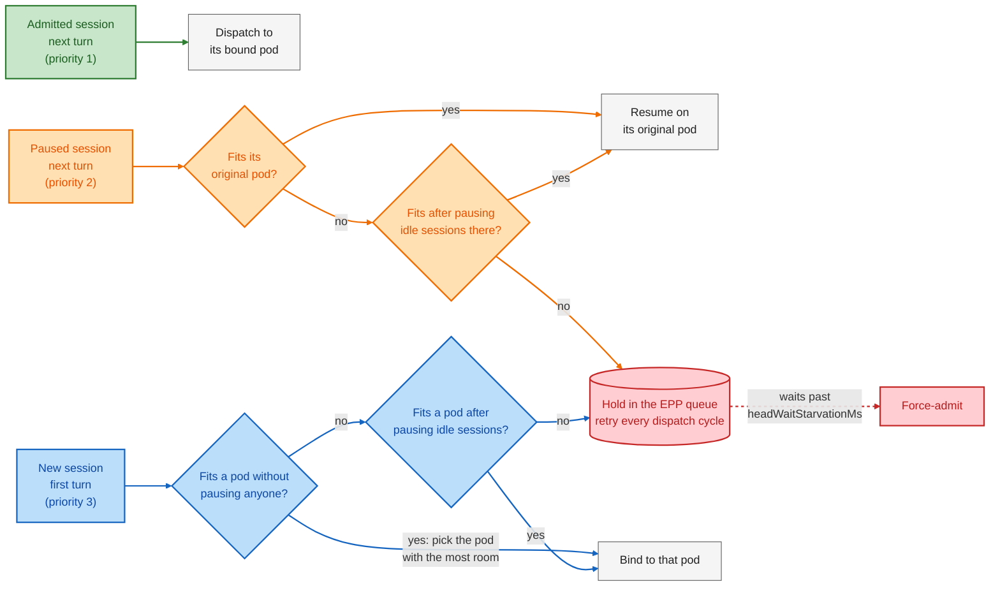
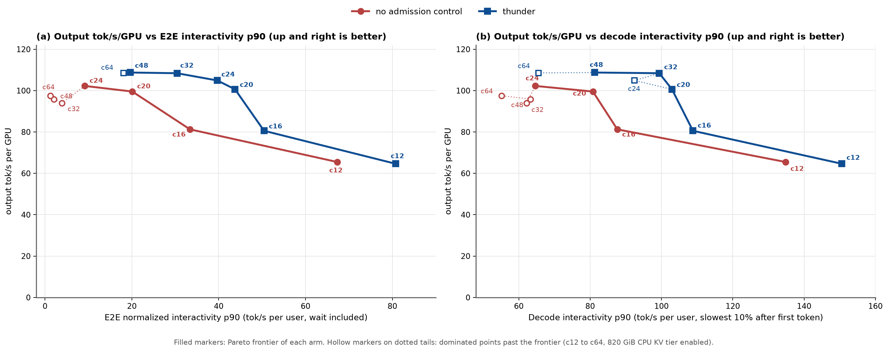
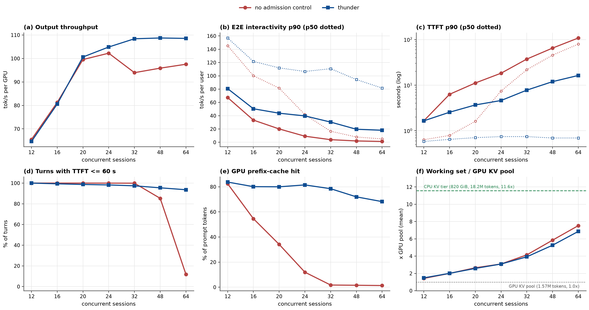
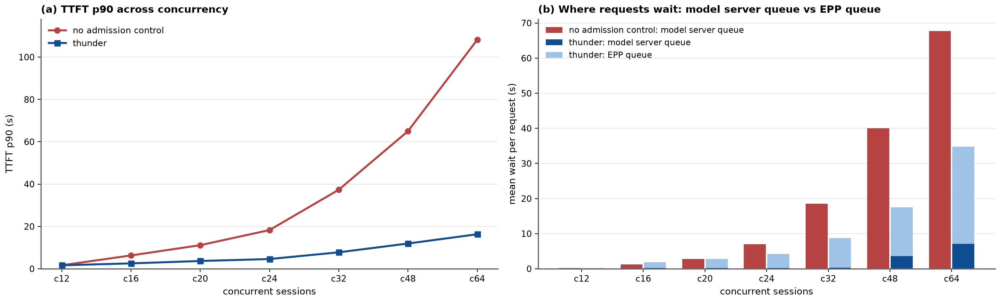

# ThunderAgent Session Admission

> [!IMPORTANT]
> **Experimental.** The `thunder-agent` plugin is **Alpha** in the llm-d Router. It holds excess
> sessions in the EPP queue so admitted sessions keep their prefixes in GPU memory. Read
> [Tuning](#tuning) and [Limitations](#limitations) before deploying it.

```text
Tier: 2 (Deployable)
Reference environment: one nvidia/GLM-5.2-NVFP4 replica at TP8 on 8x B200, vLLM 0.31,
820 GiB CPU KV tier.
The kustomize overlays pass dry-run CI, and guide.yaml validates under scripts/guide.py.
Gaps to Tier 3: no nightly end-to-end job or release-matrix status badge.
Gaps to Tier 4: the benchmark ran on a separate fleet, not against this guide's own overlay.
```

See [Guides: Definition and Policy](../GUIDES-POLICY.md) for what the tiers mean.

## Overview

Multi-turn agent sessions resend their full conversation history every turn. Prefill dominates, and
turns stay fast only while prefix blocks remain in GPU memory. When concurrent sessions exceed a
pod's GPU KV pool, the model server evicts blocks from idle sessions waiting on tool calls. Later
turns then pay for full prompt recomputation or bulk CPU-to-GPU KV reloads. Model server KV
utilization metrics miss this churn because idle blocks sit on the free list as unused.

Based on ThunderAgent ([arXiv 2602.13692](https://arxiv.org/abs/2602.13692)), the `thunder-agent`
plugin adds **session-aware KV cache admission control** in the llm-d Router. It tracks each
session's KV footprint per pod in an in-memory ledger. It admits new or paused sessions (paused:
admitted earlier, then idle past `idleLeaseSeconds`, so its room went to other sessions) only while
room remains.

The room left on each pod is:

```text
room(pod) = utilThreshold * capacity(pod) - workingSet(pod)
```

* `capacity(pod)` is the pod's total GPU KV cache in tokens, read from the model server.
* `utilThreshold` is a configurable fraction of that capacity (`1.0` in this guide).
* `workingSet(pod)` sums the KV footprints of sessions bound to that pod.

Sessions that do not fit wait in the EPP flow control queue instead of competing for GPU memory.
With CPU KV offloading in the model server, admitted sessions keep high GPU prefix-cache hit rates.
Paused sessions resume from host RAM without recomputing prompts.

> [!WARNING]
> **`thunder-agent` requires one session ID per agent trajectory.** `agent-identity` reads headers
> from Claude Code, OpenCode, Codex, and `additionalSessionHeaders` (`x-session-id` here). The
> router sets each session's flow-control fairness ID from that header automatically, while
> unlabeled requests pass untracked. Never set `x-llm-d-inference-fairness-id` to a shared tenant
> ID. Flow control puts shared IDs in one queue where one held session blocks the rest.

`agent-identity` is a required dependency, and the EPP refuses to start without it. Both plugins are
Alpha, so [`router/thunder-agent.values.yaml`](./router/thunder-agent.values.yaml) enables
`allow-experimental-plugins`. This guide builds on the [Flow Control guide](../flow-control/README.md).
See the [`thunder-agent` plugin reference](https://github.com/llm-d/llm-d-router/blob/main/pkg/epp/framework/plugins/thunderagent/README.md)
for all parameter definitions.

### How It Works

Each turn that carries a session ID belongs to one of three classes. The class sets the path that
the turn takes through admission control:

| Class | Color | Meaning |
| :--- | :--- | :--- |
| Admitted | Green | The session is bound to a pod and counts in its working set, while it runs a turn or sits idle. |
| Paused | Orange | Admission control took back the room of this idle session. Its KV blocks stay in the model server, so it must return to its original pod. |
| New | Blue | The ledger has no entry: a first turn, or a session dropped after `evictionTtlSeconds` idle. |



Rules that the diagram does not show:

1. **Idle lease.** After a turn, a session keeps its room for `idleLeaseSeconds`. Admission control
   pauses only sessions idle past the lease, longest-idle first, and never a session with a queued
   turn. Pausing changes only the ledger.
2. **Admitted turns over the ceiling.** An admitted turn dispatches even when it pushes its pod over
   `utilThreshold * capacity`. Admission control then pauses idle sessions on that pod.
3. **Priority.** Queue heads that wait past `headWaitStarvationMs` go first, oldest first. Then come
   admitted, paused, and new sessions. Within a class, the smallest session goes first. A held queue
   does not block smaller sessions that fit.
4. **Force-admit target.** A force-admitted paused session returns to its original pod and pauses
   idle sessions there. A force-admitted new session that fits no pod goes where the scheduler puts
   it.

One named `thunder-agent` instance fills four extension points, so token accounting and dispatch
decisions share one ledger:

| Slot | Role |
| :--- | :--- |
| Scheduling profile (`Scorer`) | Pins a known session to its bound pod (`1.0` vs `0.0`). Abstains for unknown or anonymous requests. |
| `flowControl.saturationDetector` | Refreshes the per-pod ledger each cycle. Always reports unsaturated so admitted turns never block. |
| `defaultPriorityBand.fairnessPolicyRef` | **Admission control.** Picks the next session queue whose head turn fits a pod. |
| Request lifecycle (`PreRequest`, `ResponseBody`) | Binds newly placed sessions and records per-turn token usage. |

## Default Configuration

Reference model server stack:

| Parameter | Value |
| :--- | :--- |
| Model | [nvidia/GLM-5.2-NVFP4](https://huggingface.co/nvidia/GLM-5.2-NVFP4) (MoE, ~743B total, 39B active, MLA) |
| Tensor Parallelism | 8 |
| Accelerator | B200 |
| GPU KV pool | FP8, `--gpu-memory-utilization=0.8`: 1,572,864 tokens |
| CPU KV tier | Native offloading (`--kv-offloading-backend=native`), 820 GiB (~18.2M tokens) |
| Speculative decode | MTP, 3 tokens |
| Batch | `--max-num-seqs=64`, `--max-num-batched-tokens=8192` |

Router settings in [`router/thunder-agent.values.yaml`](./router/thunder-agent.values.yaml):

| Setting | Value | Purpose |
| :--- | :--- | :--- |
| `capacityTokens` | `1572864` | Fallback GPU KV pool size when `vllm:cache_config_info` is absent. |
| `utilThreshold` | `1.0` | Admits sessions up to 100% of pod GPU KV capacity. |
| `idleLeaseSeconds` | `10` | Retains an idle session's room across a typical tool call. |
| `headWaitStarvationMs` | `1800000` | Force-admits a waiting queue head after 30 minutes. |
| `evictionTtlSeconds` | `3600` | Idle session state retention (must exceed `headWaitStarvationMs`). |
| `defaultRequestTTL` | `0s` | Disables TTL queue drops so held turns wait for admission. |
| `additionalSessionHeaders` | `[x-session-id]` | Session header read during verification and benchmarking. |

### Supported Hardware Backends

`thunder-agent` is a hardware-agnostic scheduling policy in the EPP. It supports every accelerator
in the [Optimized Baseline
guide](../optimized-baseline/README.md#supported-accelerators-and-model-servers). The EPP reads
per-pod capacity from the model server, so it adapts to your accelerator and model.

## Tuning

| Parameter | Guidance |
| :--- | :--- |
| Capacity and `utilThreshold` | Size admission control to the **GPU KV pool** (`utilThreshold: 1.0`), never the CPU offload tier. Setting capacity to 2x or 4x the GPU pool lets admitted sessions evict each other from HBM. GPU prefix hits then fall under 4% and median TTFT returns to model server queue wait. |
| `idleLeaseSeconds` | Match a typical tool-call gap (`10` s here). Too short a lease pauses sessions during their tool calls. Their room goes to other sessions, so the returning turn must fit its pod again and can wait in the queue. Longer leases (`30` s) hold idle footprints across tool calls under contention, cutting throughput by 7% to 10% and raising TTFT p99. |
| `headWaitStarvationMs` | Keep long (`1800000` ms, as in the benchmark). Short backstops (60 s or 300 s) force-admit held sessions early and remove the throughput gain. |
| `defaultRequestTTL` and timeouts | Keep `defaultRequestTTL` at `0s` (or higher than `headWaitStarvationMs`) to avoid HTTP 429 drops. Set proxy, route, and client timeouts higher than `headWaitStarvationMs`. The charts default to 1000 s for the standalone Envoy `ext_proc` `message_timeout` and 300 s for the GKE `GCPBackendPolicy`. [Deploy the Router](#1-deploy-the-router) raises both to 2400 s. |

## Prerequisites

* Have the [proper client tools installed on your local
  system](../../helpers/client-setup/README.md) to use this guide.
* Checkout llm-d repo:

<!-- guide:prerequisites.clone start -->
<!-- llm-d-cicd:skip start -->
```bash
export BRANCH=main # branch, tag, or commit hash
git clone https://github.com/llm-d/llm-d.git && cd llm-d && git checkout ${BRANCH}
```
<!-- llm-d-cicd:skip end -->
<!-- guide:prerequisites.clone end -->

* Set the guide environment variables:

<!-- guide:env.static start -->
```bash
export REPO_ROOT=$(realpath $(git rev-parse --show-toplevel))
export GUIDE_NAME=thunder-agent
export NAMESPACE=llm-d-thunder-agent
export MODEL_NAME=nvidia/GLM-5.2-NVFP4
export INFRA_PROVIDER=base # options: base, gke
export ROUTER_VALUES=${REPO_ROOT}/guides/${GUIDE_NAME}/router/${GUIDE_NAME}.values.yaml
export EXTRA_HELM_ARGS=
export EPP_SA=${GUIDE_NAME}-epp
```
<!-- guide:env.static end -->

* Source the common guide environment variables:

<!-- guide:env.source start -->
```bash
source ${REPO_ROOT}/guides/env.sh
```
<!-- guide:env.source end -->

* Install the required CRDs (GAIE InferencePool + llm-d.ai InferenceObjective):

<!-- guide:prerequisites.crds start -->
```bash
# GAIE_URL is automatically calculated from GAIE_VERSION at ${REPO_ROOT}/guides/env.sh
kubectl apply -f https://github.com/kubernetes-sigs/gateway-api-inference-extension/${GAIE_URL}/v1-manifests.yaml

# ROUTER_RELEASE_URL is automatically calculated from ROUTER_RELEASE_VERSION at ${REPO_ROOT}/guides/env.sh
kubectl apply -f https://github.com/llm-d/llm-d-router/${ROUTER_RELEASE_URL}/manifests.yaml
```
<!-- guide:prerequisites.crds end -->

* Create a target namespace for the installation:

<!-- guide:prerequisites.namespace start -->
```bash
kubectl create namespace ${NAMESPACE} --dry-run=client -o yaml | kubectl apply -f -
```
<!-- guide:prerequisites.namespace end -->

* [Create the `llm-d-hf-token` secret in your target namespace with the key `HF_TOKEN` matching a
  valid HuggingFace token](../../helpers/hf-token.md) to pull models.

<!-- guide:prerequisites.secrets start -->
<!-- llm-d-cicd:skip start -->
```bash
export HF_TOKEN=<your HuggingFace token>
kubectl create secret generic llm-d-hf-token \
  --from-literal="HF_TOKEN=${HF_TOKEN}" \
  --namespace "${NAMESPACE}" \
  --dry-run=client -o yaml | kubectl apply -f -
```
<!-- llm-d-cicd:skip end -->
<!-- guide:prerequisites.secrets end -->

## Installation Instructions

### 1. Deploy the Router

#### Standalone Mode

<!-- guide:deploy.standalone start -->
```bash
helm upgrade --install ${GUIDE_NAME} \
    ${ROUTER_STANDALONE_CHART} \
    -f ${REPO_ROOT}/guides/recipes/router/base.values.yaml \
    -f ${ROUTER_VALUES} \
    ${EXTRA_HELM_ARGS} \
    -n ${NAMESPACE} --version ${ROUTER_CHART_VERSION}
```
<!-- guide:deploy.standalone end -->

Raise the Envoy `ext_proc` `message_timeout` above `headWaitStarvationMs`, so Envoy keeps waiting
for the admission decision. A later `helm upgrade` resets it, so run this step again after one:

<!-- guide:deploy.standalone_timeout start -->
```bash
kubectl get configmap envoy -n ${NAMESPACE} -o yaml \
    | sed 's/message_timeout: 1000s/message_timeout: 2400s/' \
    | kubectl apply -f -
kubectl rollout restart deploy/${GUIDE_NAME}-epp -n ${NAMESPACE}
```
<!-- guide:deploy.standalone_timeout end -->

<details>
<summary><b>Gateway Mode</b></summary>

<!-- guide:deploy.gateway start -->
```bash
export PROVIDER_NAME=gke # options: none, gke, agentgateway, istio
helm upgrade --install ${GUIDE_NAME} \
    ${ROUTER_GATEWAY_CHART} \
    -f ${REPO_ROOT}/guides/recipes/router/base.values.yaml \
    -f ${REPO_ROOT}/guides/recipes/router/features/httproute-flags.yaml \
    -f ${ROUTER_VALUES} \
    ${EXTRA_HELM_ARGS} \
    --set provider.name=${PROVIDER_NAME} \
    -n ${NAMESPACE} --version ${ROUTER_CHART_VERSION}
```
<!-- guide:deploy.gateway end -->

On GKE, raise the backend timeout of the `GCPBackendPolicy` above `headWaitStarvationMs`. A later
`helm upgrade` resets it too:

<!-- guide:deploy.gateway_timeout start -->
```bash
# only for PROVIDER_NAME=gke; other providers use httpRoute.requestTimeout: 0s
kubectl patch gcpbackendpolicy ${GUIDE_NAME} -n ${NAMESPACE} --type merge \
    -p '{"spec":{"default":{"timeoutSec":2400}}}'
```
<!-- guide:deploy.gateway_timeout end -->

</details>

### 2. Deploy the Model Server

Deploys `nvidia/GLM-5.2-NVFP4` at TP8 on 8x B200 with the 820 GiB CPU KV tier (requests 100 vCPUs
and 1300 GiB of host memory). Initial startup downloads weights and pre-faults the CPU tier:

<!-- guide:deploy.modelserver start -->
```bash
kubectl apply -k ${REPO_ROOT}/guides/${GUIDE_NAME}/modelserver/gpu/vllm/${INFRA_PROVIDER}/ -n ${NAMESPACE}
```
<!-- guide:deploy.modelserver end -->

### 3. Verify the KV capacity

The EPP reads per-pod capacity from `vllm:cache_config_info` (`block_size * num_gpu_blocks`). Read
the GPU KV pool size from the model server logs:

<!-- guide:deploy.capacity start -->
```bash
kubectl logs deploy/${GUIDE_NAME}-nvidia-gpu-vllm-decode -n ${NAMESPACE} \
    | grep -oE 'GPU KV cache size: [0-9,]+ tokens' | tail -1
```
<!-- guide:deploy.capacity end -->

The reference pod reports `1,572,864` tokens (`24,576` blocks of `64`). Some models, such as
hybrid attention models, report a `cache_config_info` that does not match token capacity. For them,
add a `core-metrics-extractor` engine config for `vllm` with an empty `cacheInfoSpec`, and set
`capacityTokens`.

### 4. Enable monitoring (optional)

<!-- guide:deploy.monitoring start -->
```bash
kubectl apply -n ${NAMESPACE} -k ${REPO_ROOT}/guides/recipes/modelserver/components/monitoring
```
<!-- guide:deploy.monitoring end -->

## Verification

### 1. Get the IP of the Proxy

<!-- guide:verify.endpoint.standalone start -->
```bash
export IP=$(kubectl get service ${GUIDE_NAME}-epp -n ${NAMESPACE} -o jsonpath='{.spec.clusterIP}')
```
<!-- guide:verify.endpoint.standalone end -->

<details>
<summary><b>Gateway Mode</b></summary>

<!-- guide:verify.endpoint.gateway start -->
```bash
export IP=$(kubectl get gateway llm-d-inference-gateway -n ${NAMESPACE} -o jsonpath='{.status.addresses[0].value}')
```
<!-- guide:verify.endpoint.gateway end -->

</details>

### 2. Verify that flow control and `thunder-agent` are active

<!-- guide:verify.tests.feature_gate start -->
```bash
# -c epp: in standalone mode kubectl defaults to the Envoy sidecar, whose log never matches
kubectl logs deploy/${GUIDE_NAME}-epp -c epp -n ${NAMESPACE} | grep "Initializing Flow Control layer"
```
<!-- guide:verify.tests.feature_gate end -->

The EPP logs its parsed configuration at startup, so a non-zero count shows an active plugin:

<!-- guide:verify.tests.thunder_plugin start -->
```bash
kubectl logs deploy/${GUIDE_NAME}-epp -c epp -n ${NAMESPACE} | grep -c "thunder-agent"
```
<!-- guide:verify.tests.thunder_plugin end -->

### 3. Grant the metrics reader access

The EPP `/metrics` port authenticates via the Kubernetes API server. Apply RBAC bindings before
scraping metrics:

<!-- guide:verify.tests.metrics_rbac start -->
```bash
kubectl create clusterrole ${GUIDE_NAME}-metrics-reader \
    --verb=get --non-resource-url=/metrics \
    --dry-run=client -o yaml | kubectl apply -f -
kubectl create clusterrolebinding ${GUIDE_NAME}-metrics-reader \
    --clusterrole=${GUIDE_NAME}-metrics-reader \
    --serviceaccount=${NAMESPACE}:default \
    --dry-run=client -o yaml | kubectl apply -f -
kubectl create clusterrolebinding ${GUIDE_NAME}-epp-auth-delegator \
    --clusterrole=system:auth-delegator \
    --serviceaccount=${NAMESPACE}:${EPP_SA} \
    --dry-run=client -o yaml | kubectl apply -f -
```
<!-- guide:verify.tests.metrics_rbac end -->

### 4. Verify that the session ledger exports metrics

The plugin exports `llm_d_epp_thunder_agent_sessions` at startup with `running`, `idle`, and
`paused` series:

<!-- guide:verify.tests.ledger_loaded start -->
```bash
kubectl run curl-debug --rm -i --restart=Never \
    --image=${CURL_TEST_IMAGE} \
    --namespace="${NAMESPACE}" --env="GUIDE_NAME=${GUIDE_NAME}" \
    -- /bin/bash -c '
  TOKEN=$(cat /var/run/secrets/kubernetes.io/serviceaccount/token)
  curl -s -H "Authorization: Bearer ${TOKEN}" \
    http://${GUIDE_NAME}-epp:9090/metrics > /tmp/m.txt
  grep -q "llm_d_epp_thunder_agent_sessions" /tmp/m.txt \
    || { echo "thunder-agent is not loaded" >&2; exit 1; }
'
```
<!-- guide:verify.tests.ledger_loaded end -->

### 5. Send session-tagged traffic

Send two turns with the same `x-session-id`. Turn 1 admits and binds the session, and turn 2
dispatches immediately as an admitted session:

<!-- guide:verify.tests.session_turns start -->
```bash
for turn in 1 2; do
  curl -sS "http://${IP}/v1/chat/completions" \
    -H "Content-Type: application/json" \
    -H "x-session-id: demo-session-a" \
    -d '{"model":"'"${MODEL_NAME}"'","messages":[{"role":"user","content":"count to three"}],"max_tokens":16}' \
    -o /dev/null -w "turn ${turn}: HTTP %{http_code}\n"
done
```
<!-- guide:verify.tests.session_turns end -->

### 6. Verify session accounting

<!-- guide:verify.tests.gate_accounting start -->
```bash
kubectl run curl-debug --rm -i --restart=Never \
    --image=${CURL_TEST_IMAGE} \
    --namespace="${NAMESPACE}" --env="GUIDE_NAME=${GUIDE_NAME}" \
    -- /bin/bash -c '
  TOKEN=$(cat /var/run/secrets/kubernetes.io/serviceaccount/token)
  curl -s -H "Authorization: Bearer ${TOKEN}" \
    http://${GUIDE_NAME}-epp:9090/metrics \
    | grep -E "llm_d_epp_thunder_agent_(sessions|releases_total|endpoint_capacity_tokens|endpoint_working_set_tokens)"
'
```
<!-- guide:verify.tests.gate_accounting end -->

Expect `llm_d_epp_thunder_agent_releases_total` greater than zero, one `idle` session, and
`llm_d_epp_thunder_agent_endpoint_capacity_tokens` equal to the GPU KV pool from step 3. If
`releases_total` is absent and every `sessions` series stays zero, `agent-identity` saw no matching
session header and passed the requests untracked.

## Benchmarking

This guide uses [`llmdbenchmark`](https://github.com/llm-d/llm-d-benchmark), the standard CLI for
llm-d performance benchmarking.

> [!IMPORTANT]
> **For full benchmarking documentation and troubleshooting, see [`docs/operations/validation/benchmark.md`](../../docs/operations/validation/benchmark.md).**
> This section covers only the `thunder-agent` commands needed to drive the deployed stack.

The workload replays multi-turn coding sessions from
[`weka_traces.yaml`](https://github.com/llm-d/llm-d-benchmark/blob/main/workload/profiles/inference-perf/weka_traces.yaml.in).

### 1. Install the `llmdbenchmark` CLI

<!-- guide:benchmark.setup.install start -->
```bash
curl -sSL https://raw.githubusercontent.com/llm-d/llm-d-benchmark/main/install.sh | bash
```
<!-- guide:benchmark.setup.install end -->

<!-- guide:benchmark.setup.activate start -->
```bash
cd llm-d-benchmark
source .venv/bin/activate
llmdbenchmark --version
```
<!-- guide:benchmark.setup.activate end -->

### 2. Resolve the endpoint of the stack you just deployed

<!-- guide:benchmark.endpoint.standalone start -->
```bash
export ENDPOINT_URL="http://$(kubectl get service ${GUIDE_NAME}-epp -n ${NAMESPACE} -o jsonpath='{.spec.clusterIP}')"
export GATEWAY_CLASS=epponly # standalone mode
```
<!-- guide:benchmark.endpoint.standalone end -->

<details>
<summary><b>Gateway Mode</b></summary>

<!-- guide:benchmark.endpoint.gateway start -->
```bash
export ENDPOINT_URL="http://$(kubectl get gateway llm-d-inference-gateway -n ${NAMESPACE} -o jsonpath='{.status.addresses[0].value}')"

# Match whichever provider you used when deploying the gateway (e.g. istio, agentgateway, gke).
export GATEWAY_CLASS=istio
```
<!-- guide:benchmark.endpoint.gateway end -->

</details>

### 3. Run the benchmark profile

<!-- guide:benchmark.execute start -->
```bash
llmdbenchmark \
    --spec           guides/agentic-serving \
    run \
    --endpoint-url   "${ENDPOINT_URL}" \
    --gateway-class  "${GATEWAY_CLASS}" \
    --model          "${MODEL_NAME}" \
    --namespace      "${NAMESPACE}" \
    --harness        inference-perf \
    --workload       weka_traces.yaml \
    --overrides      'api.session_id_header_key=x-session-id,data.weka_trace_replay.trace_idle_gap_cap_seconds=10,load.request_timeout=2400,load.stages.0.timeout=3600'
```
<!-- guide:benchmark.execute end -->

`--overrides` sends the session ID in `x-session-id`, caps tool-call gaps at 10 s, and raises the
timeouts for held turns. To vary load, also set `load.stages.0.concurrent_sessions` and
`load.stages.0.num_sessions`. To compare against no admission control, point `--endpoint-url` at the
model server Service.

## Benchmarking Report

Measured with the [AgentX](https://github.com/SemiAnalysisAI/InferenceX) harness
(`aiperf --scenario agentx`) replaying Claude Code traces (`semianalysis_cc_traces_weka_062126`)
closed-loop with recorded tool-call gaps capped at 10 s. Each concurrency point ran for 60 minutes
on one 8x B200 replica with the 820 GiB CPU KV tier. Router settings match [Default
Configuration](#default-configuration). Metrics cover steady-state requests started after minute 5,
normalized per GPU. The **no admission control** baseline sends the same traffic directly to the
model server Service. Interactive charts: [benchmark
dashboard](https://zetxqx.github.io/thunderagent-original-verification/).

### Summary

Tables and figures cover 12 to 64 sessions. Under 12 sessions, the working set stays within 1.07x
the GPU KV pool and admission control holds nothing. From 12 sessions on:

* **Throughput.** Output plateaus at `108` to `109` tok/s per GPU from 32 sessions on, `11%` to `15%`
  above no admission control. The E2E frontier extends from 24 to 48 sessions. At 32 sessions, the
  first point on the plateau, TTFT p50, p90, and p99 are `0.74` s, `7.8` s, and `186` s. Without
  admission control, the same load gives `94.0` tok/s per GPU with `21.8` s, `37.3` s, and `51.1` s.
* **Latency.** TTFT p50 stays under `0.75` s at every load (no admission control reaches `79.4` s).
  TTFT p90 drops by `2.5x` to `6.6x` from 16 to 64 sessions. E2E interactivity p90 rises by `1.2x`
  at 12 sessions to `14.6x` at 64 sessions.
* **Cost.** Held sessions wait longer. TTFT p99 rises by `1.5x` to `6.4x`, and `2` to `34` turns
  reach the 1800 s backstop from 24 to 64 sessions.

**CPU KV offloading is becoming the default for inference serving. With it, the gain depends on how
many KV bytes each reload moves.**

Without a CPU tier, a GPU miss means a full prefill, so admission control helps much more. In
separate runs without offloading at 16 to 32 sessions, no admission control recomputes `95%` to
`97%` of prompt tokens. Thunder recomputes `21%` to `27%` and delivers `3.5x` to `3.9x` the output.

With offloading, the 820 GiB tier holds the whole working set (at most `7.5x` the GPU pool, against
`11.6x` for the tier). Both arms therefore recompute only `3%` to `9%` of prompt tokens, and a GPU
miss costs a CPU-to-GPU copy instead of a prefill. Admission control helps in proportion to the copy
traffic that it removes:

* **Large KV per token, large gain.** GLM-5.2 holds `48.4` KB of FP8 MLA KV per token on each GPU
  (`387` KB across 8 GPUs). Without admission control, `85%` to `96%` of prompt tokens reload from
  host RAM at 24 to 64 sessions. That is `135` to `151` TB/h, or about `5` GB/s per GPU. Thunder
  serves `68%` to `82%` from GPU memory and cuts copies to `25` to `30` TB/h, about `1` GB/s per
  GPU.
* **Small KV per token, smaller expected gain.** A model with fewer KV bytes per token, or a faster
  host-to-GPU link, pays less for each reload. The throughput gain might then shrink, and admission
  control mainly moves wait from the model server into the EPP queue. To estimate the reload traffic
  for your model, multiply the prompt tokens served from the CPU tier by the KV bytes per token.

In production, with a CPU tier, the gain of thunder is fewer CPU-to-GPU KV copies, not fewer
prefills.

### Concurrency sweep (`12` to `64` sessions)

Each cell shows `no admission control / thunder`. Bold marks the better value:

| Sessions | E2E frontier (`no admission control` / `thunder`) | Output tok/s per GPU | Decode interactivity p90 | E2E interactivity p90 | TTFT p50 (s) | TTFT p90 (s) | TTFT p99 (s) | GPU prefix hit | CPU-to-GPU KV copy (TB/h) | Forced (1800 s) |
| ---: | :--- | ---: | ---: | ---: | ---: | ---: | ---: | ---: | ---: | ---: |
| 12 | **frontier** / **frontier** | 65.5 / 64.6 | 135 / **151** | 67.3 / **80.7** | 0.64 / **0.58** | 1.7 / 1.7 | **6.4** / 9.3 | 82% / **84%** | 13.5 / **12.0** | 0 |
| 16 | **frontier** / **frontier** | 81.3 / 80.6 | 87.6 / **109** | 33.4 / **50.5** | 0.79 / **0.65** | 6.3 / **2.5** | **15.2** / 43.7 | 55% / **80%** | 57.1 / **21.5** | 0 |
| 20 | **frontier** / **frontier** | 99.5 / **101** | 80.8 / **103** | 20.1 / **43.8** | 1.61 / **0.71** | 11.2 / **3.7** | **21.2** / 80.6 | 34% / **80%** | 99.0 / **25.5** | 0 |
| 24 | **frontier** / **frontier** | 102 / **105** | 64.6 / **92.4** | 9.2 / **39.7** | 7.45 / **0.74** | 18.3 / **4.6** | **29.7** / 133 | 12% / **82%** | 140 / **25.4** | 2 |
| 32 | dominated / **frontier** | 94.0 / **108** | 62.2 / **99.4** | 3.9 / **30.4** | 21.8 / **0.74** | 37.3 / **7.8** | **51.1** / 186 | 1.7% / **79%** | 151 / **29.6** | 4 |
| 48 | dominated / **frontier** | 95.9 / **109** | 63.2 / **81.2** | 2.0 / **19.6** | 45.5 / **0.69** | 65.0 / **11.9** | **143** / 630 | 1.6% / **72%** | 147 / **29.9** | 14 |
| 64 | dominated / dominated | 97.5 / **109** | 55.2 / **65.6** | 1.2 / **18.1** | 79.4 / **0.69** | 108 / **16.3** | **165** / 1049 | 1.3% / **68%** | 135 / **25.6** | 34 |

Decode interactivity p90 is the 10th percentile of per-request decode speed after the first token.
E2E interactivity p90 divides output tokens by full turn latency, including router and model server
queue wait. CPU-to-GPU KV copy is prompt tokens served from the CPU tier times `387` KB.

### Pareto frontier



* **Without admission control, the frontier stops at 24 sessions** (`102` tok/s per GPU, TTFT p50
  `7.45` s). At 32 to 64 sessions, output drops to `94` to `98` tok/s per GPU while TTFT p50 climbs
  to `79.4` s.
* **Thunder extends the E2E frontier to 48 sessions** (`108` to `109` tok/s per GPU, TTFT p50 `0.69`
  to `0.74` s). At 64 sessions, output holds at `109` tok/s per GPU, but E2E interactivity falls
  just behind 48 sessions.

### Metrics and mechanism



Panel (f) marks the GPU KV pool (`1.0x`) and the CPU KV tier (`11.6x`).

At 24 and 32 sessions:

* **Without admission control**, `6.7` to `7.1` requests run in the model server at a time. Each
  engine step (one forward pass over the running requests) takes `24.4` to `25.2` ms.
* **With thunder**, `5.6` to `5.9` requests run at a time, because the EPP queue holds the excess
  sessions. Each step takes only `17.9` to `18.9` ms, `25%` to `27%` shorter. Output per GPU follows
  running requests divided by step time, so the shorter steps outweigh the smaller batch. The
  shorter steps line up with fewer CPU-to-GPU KV copies (`25` to `30` TB/h against `140` to `151`
  TB/h). Decode interactivity p90 rises by `1.4x` to `1.6x`.

### Queue location and tail latency



* **Lower TTFT p90 and mean wait.** Moving wait to the EPP keeps mean model server queue wait under
  `0.3` s through 32 sessions. Without admission control, it reaches `18.5` s. Total mean wait per
  request drops by `40%` to `56%` from 24 to 64 sessions. TTFT p90 is `2.5–16.3` s against `6.3–108`
  s from 16 to 64 sessions.
* **Higher p99 tail on held sessions.** TTFT p99 is `9.3–1049` s against `6.4–165` s from 12 to 64
  sessions. The `Forced` column lists turns that reach the `1800` s backstop.
* **At the frontier points.** Thunder sits on the frontier at 24 and 32 sessions. There, TTFT p99 is
  `133` s and `186` s against `29.7` s and `51.1` s. Only `2` and `4` turns reach the backstop.

## Observability

Router metrics (`llm_d_epp_thunder_agent_*`, Alpha) and the model server cache-hit query:

| Metric | Description |
| :--- | :--- |
| `endpoint_working_set_tokens{endpoint}` | Summed session KV footprint per pod. High working set with low model server KV usage indicates churn. |
| `endpoint_capacity_tokens{endpoint}` | Per-pod capacity used by admission control. Compare against model server startup logs. |
| `sessions{state}` | Tracked sessions by state: `running`, `idle`, and `paused`. |
| `releases_total{class}` | Dispatches picked by admission control, by session class (`admitted`, `paused`, `new`). |
| `delayed_dispatches_total{class}` | Dispatches that waited at least 1 s in the EPP queue. |
| `pauses_total`, `resumes_total` | Idle sessions paused to free room, and paused sessions resumed. |
| `starvation_promotions_total` | Queue heads force-admitted at `headWaitStarvationMs`. Rising counts signal sustained overload. |
| `rate(vllm:prefix_cache_hits_total[5m]) / rate(vllm:prefix_cache_queries_total[5m])` | Model server GPU prefix-cache hit ratio protected by admission control. |

To verify that admission control engaged under load, look for non-zero `pauses_total` and
`delayed_dispatches_total`. The EPP `/debug/plugins/state` endpoint also exposes session counts,
per-pod working sets, and capacities. Session IDs never appear in metrics, state dumps, or logs.

> [!TIP]
> Held queue depth (`llm_d_epp_flow_control_queue_size`) is a direct autoscaling signal. It measures
> session demand beyond pool KV capacity while admission control protects admitted sessions during
> scale-out.

## Limitations

* **Alpha stability.** Plugin parameters and metric names might change in future releases.
* **Higher tail latency on held sessions.** Held sessions can wait up to `headWaitStarvationMs`,
  which fits coding and background agents rather than strict interactive chat SLOs.
* **KV capacity is the only modeled resource.** Admission control adds no throughput for
  compute-bound workloads or cheap cache misses.
* **Single EPP replica.** The session ledger runs in-process, so multiple EPP replicas split
  accounting.
* **No end-of-session signal.** Finished sessions count as idle until another session reclaims their
  room after `idleLeaseSeconds` or `evictionTtlSeconds` expires. Agent harnesses do not need to send
  a release signal, but `idleLeaseSeconds` must match the tool-call gaps of the workload.
* **Anonymous requests pass untracked.** Requests without a session ID bypass admission control.
  Pair `thunder` with a lower-weight load scorer to place unlabeled traffic across replicas. Do not
  add `session-affinity-scorer` to the same profile.
* **Strict origin affinity on resume.** A paused session waits for its original pod (up to
  `headWaitStarvationMs`) even when another replica has spare room.

## Cleanup

<!-- guide:cleanup start -->
```bash
helm uninstall ${GUIDE_NAME} -n ${NAMESPACE}

kubectl delete clusterrolebinding ${GUIDE_NAME}-metrics-reader ${GUIDE_NAME}-epp-auth-delegator --ignore-not-found=true
kubectl delete clusterrole ${GUIDE_NAME}-metrics-reader --ignore-not-found=true

# INFRA_PROVIDER must match the value used at deploy time
kubectl delete -k ${REPO_ROOT}/guides/${GUIDE_NAME}/modelserver/gpu/vllm/${INFRA_PROVIDER}/ -n ${NAMESPACE}

kubectl delete -n ${NAMESPACE} -k ${REPO_ROOT}/guides/recipes/modelserver/components/monitoring --ignore-not-found=true
```
<!-- guide:cleanup end -->

## Further Reading

* [`thunder-agent` plugin reference](https://github.com/llm-d/llm-d-router/blob/main/pkg/epp/framework/plugins/thunderagent/README.md) - parameter definitions and admission rules.
* [`agent-identity` plugin reference](https://github.com/llm-d/llm-d-router/blob/main/pkg/epp/framework/plugins/requesthandling/requestheader/agentidentity/README.md) - session header configuration.
* [ThunderAgent paper (arXiv 2602.13692)](https://arxiv.org/abs/2602.13692) - original program-aware scheduler design.
* [Turn-Priority Fairness](../turn-priority-fairness/README.md) - orders waiting queues by conversation depth.
* [Flow Control guide](../flow-control/README.md) - router queuing infrastructure.
