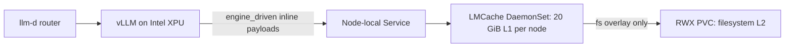

# Intel XPU LMCache MP

The `cpu/base` and `fs/base` overlays use LMCache MP with one cache server per
Intel node. This follows the [LMCache llm-d integration](https://docs.lmcache.ai/production/llm_d.html)
and replaces the [deprecated in-process connector](https://docs.lmcache.ai/legacy/index.html).
XPU runtime validation is **pending Intel capacity**.



## Configuration

The model server serves `Qwen/Qwen3-8B` with tensor parallelism 1 and one
`gpu.intel.com` DRA device. Its external connector is `LMCacheMPConnector` from
`lmcache.integration.vllm.lmcache_mp_connector`. The connection JSON is in
[`cpu/base/kv-transfer-config.json`](cpu/base/kv-transfer-config.json).

The worker uses `lmcache.mp.mp_transfer_mode=engine_driven` to copy KV data
between XPU and CPU. The server uses `--supported-transfer-mode engine_driven`
and `--shm-name ""` to carry payloads inline over ZMQ. There is no cross-pod
shared-memory mount or CUDA IPC configuration. The model pod retains its
existing private `/dev/shm` volume for vLLM.

The Service has `internalTrafficPolicy: Local`, so clients reach only a ready
cache server on their own node. An init container waits for the local server's
`/healthcheck` before starting vLLM. RPC uses port 5555. In the pinned
LMCache 0.5.0 image, the combined `lmcache server` CLI serves both
`/healthcheck` and `/metrics` on HTTP port 8080; it does not start a separate
Prometheus listener on 9090.

Both the DaemonSet and model Deployment select
`intel.feature.node.kubernetes.io/gpu: "true"`. Confirm that your Intel nodes
have this label. If your cluster uses another label, patch **both** selectors
in a site overlay. Keep any required node affinity and tolerations consistent
between them. The cache server runs on CPU and does not request an XPU DRA
device.

The model server, cache server, and wait container use the same image selected
by the shared [XPU image component](../../../../../recipes/modelserver/components/images/xpu-vllm/llm-d/kustomization.yaml).
The current `ghcr.io/llm-d/llm-d-xpu:v1.0.0` image contains LMCache 0.5.0,
vLLM 0.30.0, and PyTorch 2.13.0; the MP CLI, external connector, and native
filesystem extension imports have been checked without an XPU device.
Server and client must have identical LMCache versions, and the connector must
be compatible with the image's vLLM/PyTorch build. Upgrade all three together.
The inline wire format is version-dependent; for example, LMCache v0.5.0 uses
pickle payloads. Both processes set `PYTHONHASHSEED=0`.

## Memory and placement

[`cpu/base/lmcache-daemonset.yaml`](cpu/base/lmcache-daemonset.yaml) configures
20 GiB of L1 cache per node, 256-token chunks, and LRU eviction at 80% usage
with a 20% eviction ratio. The chunk size is a multiple of vLLM's 64-token
block size. The CPU server preallocates L1 with `--no-l1-use-lazy`; LMCache
0.5.0's lazy allocator requires CUDA.

| Pod | CPU request / limit | Memory request | Memory limit |
| --- | --- | --- | --- |
| vLLM model server | 8 / 8 | 60 GiB | 60 GiB |
| LMCache server | 2 / 2 | 25 GiB | 32 GiB |

With one model pod per node, budget at least 10 requested CPUs and 85 GiB of
requested RAM, plus node services. The DaemonSet also reserves memory on
selected Intel nodes without model pods. The server limit includes headroom
for inline payloads and staging buffers; measure peak memory under the
intended concurrency before tuning it.

Model rollouts use `maxSurge=0` and `maxUnavailable=1` to release the existing
pod's XPU before starting its replacement. Expect a brief interruption with
the default single replica.

The 20 GiB pool is shared by every model pod on a node. It is not 20 GiB per
pod or per tensor-parallel rank. The router's CPU `lruCapacityPerServer=2275`
estimate assumes one Qwen3-8B pod per node. Divide that capacity among pods
if several share a node, and revisit it when changing the model or L1 size.

## Deployment

Use the root [tiered-prefix-cache guide](../../../../README.md) for router,
secret, and namespace setup. Select:

```bash
export ACCELERATOR_TYPE=xpu
export MODEL_SERVER=vllm
export CONNECTOR=lmcache-connector
export VARIANT=cpu # or fs
export INFRA_PROVIDER=base
export MODEL=Qwen/Qwen3-8B
```

For `fs`, provision `llm-d-kv-cache-storage` as a ReadWriteMany PVC first.
Apply the selected overlay after adapting node placement:

```bash
kubectl apply -n "${NAMESPACE}" \
  -k "${REPO_ROOT}/guides/tiered-prefix-cache/modelserver/xpu/vllm/lmcache-connector/${VARIANT}/base"
kubectl rollout status -n "${NAMESPACE}" daemonset/xpu-vllm-lmcache
kubectl rollout status -n "${NAMESPACE}" deployment/xpu-vllm-decode
kubectl get pods -n "${NAMESPACE}" -o wide \
  -l llm-d.ai/subguide=tiered-prefix-cache-xpu-lmcache
```

Cache pods deliberately omit `llm-d.ai/guide=tiered-prefix-cache`, which the
router uses to discover model pods. Model pods retain that label and have
`llm-d.ai/lmcache-mode=mp` for the nightly verifier.

An existing in-process Deployment can be updated by applying this overlay.
The generated ConfigMap hash triggers a model rollout when connection
configuration changes. After changing server arguments, upgrading its image,
or switching between `cpu` and `fs`, wait for the DaemonSet rollout and then
restart the model Deployment so clients register with the replacement servers:

```bash
kubectl rollout status -n "${NAMESPACE}" daemonset/xpu-vllm-lmcache
kubectl rollout restart -n "${NAMESPACE}" deployment/xpu-vllm-decode
kubectl rollout status -n "${NAMESPACE}" deployment/xpu-vllm-decode
```

Restarting a CPU-only cache server loses its L1 contents.

## Filesystem tier

[`fs/base/patch-lmcache.yaml`](fs/base/patch-lmcache.yaml) mounts the shared PVC
at `/mnt/files-storage` **on the cache servers** and adds a `fs_native` L2
adapter. Model pods do not mount the offload PVC.

The adapter uses `/mnt/files-storage/kv-cache/mp` to separate MP files from
legacy in-process cache files. Leave old files intact during migration; this
overlay does not read or convert them. Changing LMCache versions, models, or
cache layouts may require another cache directory.

`max_capacity_gb=100` and the adapter's `eviction` configuration enable LRU
eviction against a 100 GiB usage target. Tracking covers files written by the
current server process; it is not a global PVC quota and does not account for
all files left by previous processes or other nodes. Set storage-level quotas
or cleanup policies for the shared filesystem.

The `fs_native` adapter requires the image's `lmcache.lmcache_fs` extension.
The overlay preserves direct I/O with `"use_odirect": true`. Confirm filesystem
support and buffer alignment before deployment. The default `--l1-align-bytes`
is 4096; larger filesystem blocks may need a larger alignment and compatible
chunk size. Set `"use_odirect": false` while establishing correctness on a
filesystem whose requirements are unknown.

## Metrics and verification

Read cache-server metrics separately from the model server's port 8000:

```bash
for pod in $(kubectl get pods -n "${NAMESPACE}" \
    -l app.kubernetes.io/name=lmcache,app.kubernetes.io/instance=tiered-prefix-cache-xpu \
    -o jsonpath='{.items[*].metadata.name}'); do
  echo "== ${pod}"
  kubectl get --raw "/api/v1/namespaces/${NAMESPACE}/pods/${pod}:8080/proxy/metrics" \
    | grep -E '^lmcache_mp_(l1_(write|read|memory_usage)|l2_(store_completed|load_completed))'
done
```

After long-prefix requests, `lmcache_mp_l1_write_chunks_total` should increase.
For `fs`, also check `lmcache_mp_l2_store_completed_objects_chunks_total` and
files under `/mnt/files-storage/kv-cache/mp` inside a cache-server pod.
The nightly verifier uses these counters and inspects the cache-server PVC
for MP deployments; native connector checks continue to use model-pod metrics.
Use a previously uncached prefix when checking store counters; an existing
filesystem hit may not produce a new L2 store.

With the Prometheus Operator installed, the root guide's `MONITORING=true`
step also deploys the [cache-server PodMonitor](monitoring/). It can be applied
separately:

```bash
kubectl apply -n "${NAMESPACE}" \
  -k "${REPO_ROOT}/guides/tiered-prefix-cache/modelserver/xpu/vllm/lmcache-connector/monitoring"
```

### Completed local validation

Both overlays render successfully and pass strict Kubernetes client-side
validation. Guide consistency checks and all 35 verifier unit tests pass.
CPU-only smoke tests using the pinned XPU image confirmed inline engine
registration, L1 store and retrieval with identical tensor payloads, and
health/metrics endpoints for both variants. The filesystem test also confirmed
native direct-I/O stores and retrieval with identical payloads after restarting
the server with an empty L1 and the same local filesystem directory.

These tests used CPU tensors without an XPU device. They do not validate
XPU transfers, vLLM inference, node-local Kubernetes routing, or the target RWX
filesystem.

### Runtime validation pending

The available Kubernetes context is `shared-infra-context`, restricted to
namespace `shared-infra`, with no Intel capacity available. No XPU deployment
or end-to-end validation has been performed there.

Once Intel capacity is available, validate both overlays:

1. Confirm the Intel node label, DRA class, image versions, and memory budget;
   for `fs`, confirm a Bound RWX PVC and writable cache directory.
2. Confirm a ready cache server on each model node, successful worker
   registration in the logs, and completion of a long-prefix request.
3. Pin a test model pod to one Intel node, prime a prefix with deterministic
   generation, and confirm positive L1 store counters. Keep the cache server
   running while restarting only vLLM to clear HBM, then repeat the request.
   Require an increase in `vllm:external_prefix_cache_hits_total`, cache-server
   reads, and identical output. Warm HBM hits alone do not prove MP retrieval.
4. For `fs`, prime and wait for completed L2 stores, then restart the cache
   server and vLLM while preserving the PVC. Repeat the prefix and require L2
   loads, external prefix hits, and identical output.
5. Measure store/load latency and peak memory under concurrency, and exercise
   coordinated server/model restarts before relying on the deployment.

Production overlays keep vLLM prefix caching enabled. Disabling it temporarily
is another way to isolate external-cache retrieval during a test.

## Cleanup

Deleting the selected model overlay also deletes its DaemonSet, Service, and
connector ConfigMap. Delete the optional cache PodMonitor separately or follow
the root guide's cleanup steps. PVC deletion and legacy cache-file cleanup
remain separate operations.
